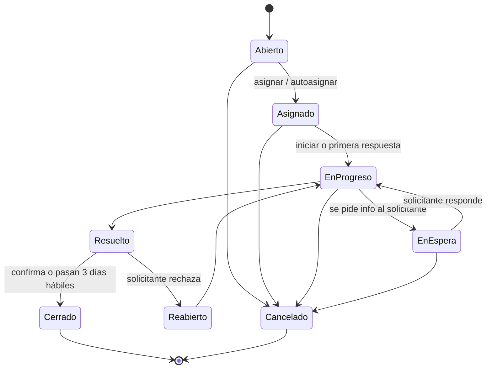
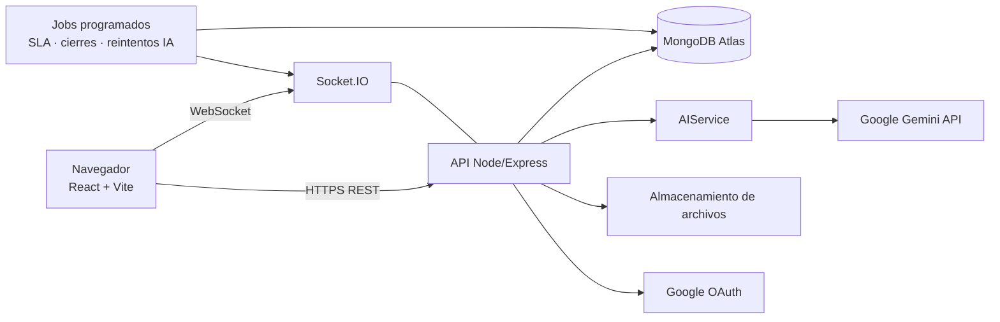
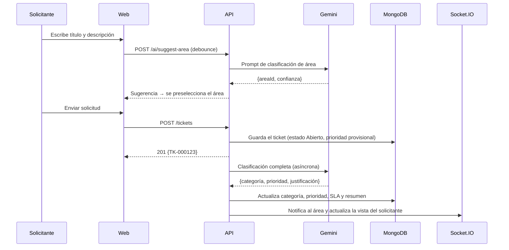

# Tekzaya — Documento de Especificación del Sistema

> **Plataforma web de gestión de tickets de soporte y mantenimiento de activos empresariales, asistida por inteligencia artificial.**

| Campo | Valor |
|---|---|
| Asignatura | Proyecto Emprendedor 2 |
| Versión del documento | 1.0 (borrador para validación) |
| Fecha | 22 de septiembre de 2026 |
| Fase cubierta en detalle | Fase 1: Gestión de tickets de soporte |
| Documento de origen | `tekzaya.md` + imágenes de `ideas_diseno/` |

---

## Índice

1. [Resumen ejecutivo](#1-resumen-ejecutivo)
2. [Contexto del proyecto](#2-contexto-del-proyecto)
3. [Alcance y fases](#3-alcance-y-fases)
4. [Actores, roles y permisos](#4-actores-roles-y-permisos)
5. [Conceptos del dominio: tickets, estados, prioridades y SLA](#5-conceptos-del-dominio)
6. [Inteligencia artificial en Tekzaya](#6-inteligencia-artificial-en-tekzaya)
7. [Fase 1: especificación de pantallas](#7-fase-1-especificación-de-pantallas)
8. [Notificaciones](#8-notificaciones)
9. [Métricas: definiciones y fórmulas](#9-métricas-definiciones-y-fórmulas)
10. [Arquitectura técnica](#10-arquitectura-técnica)
11. [Modelo de datos (MongoDB)](#11-modelo-de-datos-mongodb)
12. [API REST (resumen)](#12-api-rest-resumen)
13. [Requisitos no funcionales](#13-requisitos-no-funcionales)
14. [Fase 2: gestión de mantenimiento (visión)](#14-fase-2-gestión-de-mantenimiento-visión)
15. [Plan de trabajo sugerido](#15-plan-de-trabajo-sugerido)
16. [Riesgos y mitigaciones](#16-riesgos-y-mitigaciones)
17. [Cambios respecto al documento original](#17-cambios-respecto-al-documento-original)
18. [Supuestos y preguntas abiertas](#18-supuestos-y-preguntas-abiertas)
19. [Glosario](#19-glosario)

---

## 1. Resumen ejecutivo

**Tekzaya** es una aplicación web que reúne en un solo lugar dos procesos que en muchas empresas están dispersos entre correos, llamadas, hojas de cálculo y mensajes de chat:

1. **Soporte interno por tickets.** Cualquier empleado reporta una incidencia o solicitud. La IA la clasifica (área destino, categoría y prioridad), el área correspondiente la atiende y el sistema mide tiempos y cumplimiento.
2. **Mantenimiento de activos.** Inventario de equipos, historial de averías, mantenimientos preventivos programados, repuestos y costos.

La **Fase 1** entrega el módulo de tickets completo: autenticación, tableros por rol, listado y creación de tickets, conversación con notas públicas e internas, asignación, SLA, notificaciones, encuesta de satisfacción y administración de usuarios y áreas. La **Fase 2** añade el módulo de mantenimiento y lo enlaza con los tickets (por ejemplo, un ticket asociado a un equipo concreto).

---

## 2. Contexto del proyecto

> Esta sección es una **propuesta** para el componente emprendedor de la asignatura. Conviene validarla con el docente y con el equipo.

### 2.1 Problema

- Las solicitudes internas llegan por muchos canales (correo, WhatsApp, pasillo) y **se pierden o se duplican**.
- No hay **prioridad objetiva**: se atiende primero a quien insiste más, no lo más crítico.
- Los supervisores **no pueden medir** carga de trabajo, tiempos de respuesta ni desempeño de su equipo.
- El conocimiento de cómo se resolvió un problema **no queda registrado**.
- El mantenimiento de equipos suele ser **reactivo**: se repara cuando falla, sin historial ni costos consolidados.

### 2.2 Propuesta de valor

| Para… | Tekzaya ofrece… |
|---|---|
| Empleados | Un único lugar para pedir ayuda y ver el estado de su solicitud sin tener que preguntar. |
| Técnicos / miembros de área | Tickets ya clasificados y resumidos por IA, sugerencias de solución y autocompletado de respuestas. |
| Supervisores | Visibilidad de la carga de cada persona, asignación informada y métricas del área. |
| Dirección / RRHH | Indicadores globales de servicio y desempeño por área y persona. |

### 2.3 Público objetivo

Pequeñas y medianas empresas (pymes) de habla hispana, de 20 a 500 empleados, sin una mesa de ayuda formal o que usan herramientas genéricas.

### 2.4 Competencia de referencia

| Herramienta | Observación |
|---|---|
| Jira Service Management, Zendesk, Freshdesk | Completas pero caras y complejas para una pyme; orientadas a soporte de clientes externos. |
| GLPI, osTicket | Gratuitas y de código abierto, pero con una interfaz anticuada y sin IA integrada. |
| **Tekzaya (diferenciador)** | Interfaz moderna en español, IA integrada desde el primer ticket, y **soporte + mantenimiento de activos en una sola herramienta**. |

---

## 3. Alcance y fases

### 3.1 Decisiones de alcance

| Decisión | Valor acordado |
|---|---|
| Tipo de despliegue | **Una sola empresa** (instancia única). El modo multiempresa (SaaS) queda como evolución futura. |
| Idioma de la interfaz | Español. |
| Dispositivos | Web responsiva (escritorio como prioridad; tablet y móvil funcionales). |

### 3.2 Fase 1: gestión de tickets (entregable principal)

**Incluye:**
- Inicio de sesión con Google y con correo y contraseña.
- Tableros (dashboard) por rol: empleado, supervisor de área, supervisor de RRHH y administrador.
- Listado de tickets en tres vistas: **lista**, **agrupada** y **Kanban**.
- Creación de tickets con departamento sugerido por IA.
- Detalle del ticket con conversación, **notas públicas e internas**, autocompletado con IA (tecla Tab), resumen automático y sugerencias de solución.
- Asignación por supervisor (con visión de carga) y autoasignación.
- Estados, prioridades y **SLA** con alertas de vencimiento.
- Notificaciones dentro de la aplicación, en tiempo real.
- **Encuesta de satisfacción** (CSAT) al resolver.
- **Administración** de usuarios, áreas, categorías y SLA.

**No incluye (queda para fases posteriores):**
- Módulo de mantenimiento y activos (Fase 2).
- Notificaciones por correo electrónico.
- Base de conocimientos (artículos de solución).
- Aplicación móvil nativa.
- Multiempresa y planes de suscripción.

### 3.3 Fase 2: mantenimiento de activos

Descrita a nivel de visión en la [sección 14](#14-fase-2-gestión-de-mantenimiento-visión).

---

## 4. Actores, roles y permisos

### 4.1 Principio básico

**Todo empleado pertenece a un área, y todo miembro de un área puede atender los tickets dirigidos a ella.** Por lo tanto, un mismo usuario tiene dos facetas:

- **Solicitante:** crea tickets hacia cualquier área, incluida la suya.
- **Agente de su área:** ve, toma y resuelve los tickets que llegan a su área.

Por eso el tablero del empleado muestra "tickets resueltos por mí" y "tickets pendientes para mí".

### 4.2 Roles

| Rol | Descripción |
|---|---|
| **Empleado** | Rol base. Crea tickets, da seguimiento a sus solicitudes y atiende los tickets de su área (se autoasigna o recibe asignaciones). |
| **Supervisor de área** | Empleado con permisos adicionales sobre **su área**: asigna y reasigna tickets, ve todas las conversaciones del área (incluidas las notas internas), cambia prioridades y ve las estadísticas del área. Puede haber uno o más supervisores por área. |
| **Supervisor de RRHH** | Supervisor de su propia área (RRHH) **más una vista global de solo lectura** de las estadísticas de todas las áreas y personas. No configura el sistema, no gestiona usuarios y no asigna tickets de otras áreas. |
| **Administrador** | Control total: gestiona usuarios, áreas, categorías, SLA y configuración; ve estadísticas globales; puede asignar o reasignar cualquier ticket. |

> **Implementación sugerida:** en lugar de un único campo "rol", conviene guardar
> `role: "employee" | "admin"`, `areaId`, `isAreaSupervisor: boolean` y `hasGlobalReadAccess: boolean` (para RRHH).
> Así se pueden combinar permisos sin crear roles duplicados.

### 4.3 Matriz de permisos (Fase 1)

| Acción | Empleado | Supervisor de área | Supervisor de RRHH | Admin |
|---|:-:|:-:|:-:|:-:|
| Crear ticket (hacia cualquier área) | ✅ | ✅ | ✅ | ✅ |
| Ver y responder sus propios tickets creados | ✅ | ✅ | ✅ | ✅ |
| Ver los tickets dirigidos a su área | ✅ | ✅ | ✅ (su área) | ✅ (todas) |
| Autoasignarse un ticket de su área | ✅ | ✅ | ✅ | ✅ |
| Asignar o reasignar a otra persona | ❌ | ✅ (su área) | ✅ (solo su área) | ✅ |
| Escribir y ver notas internas | ✅ (su área) | ✅ (su área) | ✅ (su área) | ✅ |
| Cambiar la prioridad sugerida por la IA | ❌ | ✅ (su área) | ✅ (su área) | ✅ |
| Transferir un ticket a otra área | ✅ si está asignado a él | ✅ | ✅ (su área) | ✅ |
| Cambiar el estado de un ticket asignado a él | ✅ | ✅ | ✅ | ✅ |
| Cancelar su propio ticket (si no está resuelto) | ✅ | ✅ | ✅ | ✅ |
| Tablero personal | ✅ | ✅ | ✅ | ✅ |
| Tablero de área | ❌ | ✅ (su área) | ✅ (todas, solo lectura) | ✅ (todas) |
| Estadísticas de una persona concreta | ❌ | ✅ (de su área) | ✅ (cualquiera) | ✅ (cualquiera) |
| Gestionar usuarios, áreas, categorías y SLA | ❌ | ❌ | ❌ | ✅ |

**Regla de privacidad:** un solicitante **nunca** ve las notas internas, aunque pertenezca al área que atiende otro ticket suyo. Solo las ve cuando actúa como agente del área destino.

---

## 5. Conceptos del dominio

### 5.1 Anatomía de un ticket

| Campo | Origen | Notas |
|---|---|---|
| Número (`TK-000123`) | Sistema | Secuencial, legible; distinto del `_id` interno. |
| Título | Solicitante | Obligatorio, de 5 a 120 caracteres. |
| Descripción | Solicitante | Obligatoria, de 10 a 5000 caracteres. |
| Adjuntos | Solicitante / agentes | Hasta 5 archivos por mensaje, 10 MB cada uno. Formatos: PNG, JPG, PDF, TXT, LOG, DOCX, XLSX. |
| Área destino | IA sugiere, el solicitante confirma | Editable por el solicitante antes de enviar. |
| Categoría | IA | Depende del área (por ejemplo, IT → "Redes y conectividad"). |
| Prioridad | IA | Editable solo por el supervisor o el admin, con motivo obligatorio. |
| Solicitante | Sistema | Usuario que lo crea. |
| Asignado a | Supervisor, admin o autoasignación | Una sola persona responsable. |
| Estado | Sistema y agentes | Ver la [sección 5.2](#52-estados-y-ciclo-de-vida). |
| Fechas clave | Sistema | Creación, primera respuesta, resolución, cierre y vencimientos de SLA. |
| Resumen de IA | IA | Se regenera cuando la conversación cambia de forma significativa. |
| Calificación CSAT | Solicitante | De 1 a 5, con comentario opcional. |

### 5.2 Estados y ciclo de vida

| Estado | Significado | ¿Quién lo pone? |
|---|---|---|
| **Abierto** | Creado, sin responsable. | Sistema, al crear el ticket. |
| **Asignado** | Tiene responsable, pero aún no se empezó a trabajar. | Sistema, al asignar. |
| **En progreso** | El responsable está trabajando en él. | Agente (o automático con su primera respuesta pública). |
| **En espera** | Se necesita información o una acción del solicitante. **El reloj del SLA se pausa.** | Agente. |
| **Resuelto** | El agente considera que el problema quedó solucionado. Se envía la encuesta CSAT. | Agente. |
| **Cerrado** | Estado final. El solicitante confirma la solución, o el ticket se cierra solo tras **3 días hábiles** en "Resuelto" (valor configurable). | Solicitante o sistema. |
| **Reabierto** | El solicitante indica que no se resolvió (solo mientras está en "Resuelto"). Vuelve al mismo responsable. | Solicitante. |
| **Cancelado** | El solicitante retira la solicitud, o un supervisor la descarta (duplicado, improcedente). Requiere motivo. | Solicitante o supervisor. |



**Reglas adicionales:**
- Si el solicitante responde mientras el ticket está **En espera**, el estado vuelve automáticamente a **En progreso**.
- Si pasan **5 días hábiles** en "En espera" sin respuesta del solicitante, se le recuerda; a los 10 días se puede cerrar automáticamente (configurable).
- **Transferir** a otra área devuelve el ticket a "Abierto" en el área nueva, sin responsable, y queda registrado en el historial (sirve también para medir los errores de clasificación de la IA).

### 5.3 Prioridades y SLA

La IA asigna la prioridad al crear el ticket. Los tiempos se miden en **horario laboral** (por defecto de lunes a viernes, de 08:00 a 18:00, configurable), excepto en "Urgente".

| Prioridad | Criterio orientativo (lo usa la IA) | 1.ª respuesta | Resolución |
|---|---|---|---|
| 🔴 **Urgente** | Paraliza la operación o afecta a muchas personas; riesgo de seguridad o económico inmediato. | 15 min | 4 h |
| 🟠 **Alta** | Impide trabajar a una persona o equipo, sin alternativa. | 1 h | 8 h |
| 🟡 **Media** | Afecta el trabajo pero existe una alternativa temporal. | 4 h | 24 h |
| 🟢 **Baja** | Consultas, solicitudes planificables, mejoras. | 8 h | 72 h |

> **Pendiente de decidir:** si "Urgente" se mide en horario 24/7 o solo en horario laboral.
> Por defecto se propone **horario laboral para todo**, porque la Fase 1 no contempla guardias.

**Estados de SLA de un ticket:** `En tiempo` → `En riesgo` (se consumió el 75 % del tiempo) → `Vencido`. Se muestran con color en la lista y generan notificaciones (ver la [sección 8](#8-notificaciones)).

Los tiempos de la tabla son **valores iniciales editables por el administrador**.

### 5.4 Áreas y categorías iniciales (datos semilla)

| Área | Categorías de ejemplo |
|---|---|
| IT y Sistemas | Hardware, Software, Redes y conectividad, Accesos y cuentas, Correo, Impresoras |
| Mantenimiento | Eléctrico, Plomería, Climatización, Mobiliario, Limpieza |
| Recursos Humanos | Nómina, Vacaciones y permisos, Documentos y constancias, Beneficios |
| Ventas | Cotizaciones, Clientes, Comisiones |
| Marketing | Material gráfico, Redes sociales, Eventos |
| Finanzas | Reembolsos, Pagos a proveedores, Facturación |

El administrador puede crear, editar y desactivar áreas y categorías. **Un área solo puede recibir tickets si tiene al menos un miembro activo.**

---

## 6. Inteligencia artificial en Tekzaya

### 6.1 Proveedor

- **Google Gemini API, plan gratuito**, con un modelo de la familia *Flash* por su velocidad y bajo costo.
- Todas las llamadas pasan por un **servicio interno `AIService`** en el backend, con una interfaz propia. Así se puede cambiar de proveedor (Groq, Ollama o un plan de pago) sin tocar el resto del sistema.
- La clave de API vive **solo en el backend**, nunca en el navegador.

> ⚠️ **Advertencia importante sobre el plan gratuito:** en el plan gratuito de Gemini, Google puede usar el contenido enviado para mejorar sus productos, y los límites de uso (peticiones por minuto y por día) son bajos y pueden cambiar. Para el prototipo académico es aceptable, pero:
> - **No se deben enviar datos sensibles reales** (contraseñas, datos personales, datos de clientes).
> - En producción habría que pasar a un plan de pago o a un modelo local.
> - Conviene revisar los términos y límites vigentes en la documentación oficial antes de empezar.

### 6.2 Funciones de IA en la Fase 1

| # | Función | Cuándo se ejecuta | Entrada | Salida |
|---|---|---|---|---|
| IA-1 | **Sugerencia de área** | Mientras el usuario escribe el título y la descripción (con *debounce* de ~800 ms y un mínimo de 20 caracteres). | Título + descripción + lista de áreas activas. | Área sugerida + confianza (0 a 1). |
| IA-2 | **Clasificación completa** | Al enviar el ticket (de forma asíncrona). | Título, descripción, área elegida y categorías del área. | Categoría, prioridad, justificación breve y confianza. |
| IA-3 | **Resumen automático** | Al crear el ticket y cada vez que se añaden 3 mensajes nuevos, o a petición ("Regenerar"). | Descripción + conversación (incluidas las notas internas; solo lo ven los agentes). | Resumen de 3 a 5 líneas: problema, lo intentado y el estado actual. |
| IA-4 | **Sugerencias de solución** | Al abrir el ticket como agente, o a petición. | Resumen + categoría + tickets resueltos similares del área. | De 3 a 5 pasos recomendados + enlaces a tickets similares ya resueltos. |
| IA-5 | **Autocompletado con Tab** | Mientras el agente escribe una respuesta, tras una pausa de ~600 ms. | Contexto del ticket + texto parcial. | Continuación en texto gris ("ghost text"); **Tab** la acepta y **Esc** la descarta. |

**Formato:** las funciones IA-1 e IA-2 deben pedir al modelo **salida JSON estructurada** (con un esquema definido) y validarla en el backend antes de guardarla.

### 6.3 Reglas de robustez

- **La IA nunca bloquea el flujo.** Si Gemini falla, excede la cuota o responde algo inválido:
  - El ticket se crea igual, con el área elegida por el usuario, prioridad **Media** y la etiqueta *"Pendiente de clasificación"*. Un reintento en segundo plano vuelve a intentarlo.
  - El autocompletado y las sugerencias simplemente no aparecen.
- **Cuotas:** limitar el autocompletado por usuario (por ejemplo, 1 petición cada 2 s) y guardar en caché los resúmenes y sugerencias para no gastar la cuota gratuita.
- **Trazabilidad:** guardar en el ticket qué sugirió la IA (área, prioridad y confianza) y qué se decidió finalmente. Esto permite mostrar la **precisión de la IA** como métrica del proyecto, que además es un buen dato para la defensa.
- **Prompt injection:** el texto del usuario se trata como datos, no como instrucciones. Se delimita en el prompt y la salida siempre se valida contra el esquema.

---

## 7. Fase 1: especificación de pantallas

### 7.0 Estructura general (layout)

Basada en `crear_ticket.png` y `crear_ticket2.png`:

- **Barra lateral izquierda:** logo de Tekzaya · Tablero · Tickets (con contador) · *Activos y mantenimiento (deshabilitado, con la etiqueta "Próximamente")* · Reportes (supervisores, RRHH y admin) · sección **Administración** (solo admin): Usuarios, Áreas y categorías, Configuración.
- **Barra superior:** buscador global (tickets por número o título) · botón **"+ Nuevo ticket"** siempre visible · campana de notificaciones con contador · selector de tema claro/oscuro · avatar con nombre, área y rol, y menú (perfil, cerrar sesión).
- **Estilo visual:** limpio, con tarjetas blancas de bordes redondeados sobre un fondo gris claro, un color de marca (azul, como en las referencias) y colores semánticos consistentes para prioridad y estado.

### 7.1 Login

**Objetivo:** atractivo y con poco texto.

**Diseño:**
- Pantalla dividida: a la izquierda una ilustración o degradado de marca con el logo y un eslogan corto (por ejemplo, *"Soporte y mantenimiento, en un solo lugar."*); a la derecha el formulario.
- Botón principal: **"Continuar con Google"**.
- Separador "o".
- Campos de correo y contraseña, botón "Iniciar sesión" y enlace "¿Olvidaste tu contraseña?".
- En móvil se muestra solo el formulario.

**Reglas:**
- **No hay registro público.** Como es una sola empresa, **el administrador invita a los usuarios** (se les asigna área y rol). Al aceptar la invitación, el usuario define su contraseña o entra directamente con Google.
- El inicio de sesión con Google solo funciona si el correo **ya está registrado** o pertenece al **dominio corporativo permitido** (configurable, por ejemplo `@empresa.com`). Un correo desconocido recibe el mensaje *"Tu cuenta no está habilitada. Contacta al administrador."*
- Contraseñas: mínimo 8 caracteres, con letras y números; se guardan con hash **bcrypt**.
- Bloqueo temporal tras 5 intentos fallidos (15 min).
- Sesión: *access token* JWT de corta duración (15 min) y *refresh token* en una cookie `httpOnly` (7 días).
- Recuperación de contraseña: en la Fase 1 no se envía correo, así que **el administrador genera un enlace de restablecimiento** desde la gestión de usuarios. Quedará automatizado cuando se agregue el correo.

### 7.2 Tablero (dashboard)

Es la primera pantalla después del login. Encabezado con saludo (*"Hola, Andrés 👋"*) y una frase de atención (*"Tienes 3 tickets que requieren tu atención"*), como en `ticket_lista.png`.

**Filtro de período (común a todas las gráficas):** `Día | Semana | Mes | Año`, más un **rango personalizado**. La granularidad del eje X se ajusta al período: Día → horas, Semana → días, Mes → días o semanas, Año → meses.

#### 7.2.1 Tablero del empleado (vista personal)

**Fila superior: 4 tarjetas de indicadores (KPI)**

| Tarjeta | Definición exacta |
|---|---|
| Pendientes del área | Tickets de **mi área** en un estado distinto de Resuelto, Cerrado o Cancelado. |
| Resueltos por mí | Tickets que **yo** resolví en el período seleccionado. |
| Pendientes para mí | Tickets **asignados a mí** que aún no están resueltos. |
| Urgentes | Tickets con prioridad **Urgente** sin resolver, **asignados a mí o sin asignar en mi área**. |

> ✏️ **Ajuste respecto al original:** "total de tickets pendientes" era ambiguo. Se interpretó como los **pendientes del área**, porque "pendientes para mí" ya cubre los personales. Hay que confirmarlo.

Cada tarjeta es **clicable** y lleva a la lista de tickets con el filtro correspondiente aplicado. Opcionalmente puede mostrar la variación respecto al período anterior (por ejemplo, "+8 % vs. semana pasada"), como en `dashboard.webp`.

**Zona central: dos columnas**

- **Izquierda (aprox. 2/3): gráfica de tickets resueltos por mí** a lo largo del tiempo (barras o línea), con el filtro de período. Muestra también la línea del período anterior en gris para comparar.
- **Derecha (aprox. 1/3): panel "Mis solicitudes"**, con los **5 tickets más recientes que creé**, ordenados por última actividad:
  1. **Sin respuesta:** `TK-000123 · Título` + etiqueta gris *"Sin respuesta"*.
  2. **Con respuesta:** `TK-000123 · Título` + avatar y nombre de quien respondió + un fragmento de la última respuesta pública (2 líneas) + un punto azul si hay respuestas no leídas. Al hacer clic se abre el detalle del ticket, listo para leer y responder.
  3. **Sin tickets:** un estado vacío amigable con ilustración, el texto *"Aún no has creado solicitudes"* y el botón **"Crear mi primer ticket"**.
  - Enlace al pie: *"Ver todas mis solicitudes"*.

> ✏️ **Mejora:** también se muestra el **estado** de cada solicitud (En progreso, En espera…), y si el ticket está **En espera** se destaca con *"Necesita tu respuesta"*, porque es la acción más importante para el solicitante.

#### 7.2.2 Tablero del supervisor de área

Un **interruptor** en la parte superior: `Mi área (predeterminado) | Personal`. La vista **Personal** es idéntica a la del empleado.

**Vista "Mi área": 3 tarjetas KPI (+1 opcional)**

| Tarjeta | Definición |
|---|---|
| Tickets pendientes | Tickets del área sin resolver (y cuántos están **sin asignar**). |
| Tickets resueltos | Resueltos por el área en el período. |
| Tiempo medio de primera respuesta | Promedio del período, en horas laborales; con color según el SLA. |
| *(Opcional)* Cumplimiento de SLA / CSAT | % de tickets resueltos dentro del SLA y satisfacción media (1-5). |

**Gráficas (cuadrícula de 2×2):**

| # | Gráfica | Tipo | Detalle |
|---|---|---|---|
| G1 | Tickets resueltos por persona | Barras horizontales | Una barra por miembro del área, ordenadas de mayor a menor. |
| G2 | Tiempo medio de respuesta por persona | Barras horizontales | Misma lista de personas y orden que G1 para comparar; línea vertical con la meta de SLA. |
| G3 | Solicitudes por tipo | Dona (circular) | "Tipo" = **categoría** del ticket. Máximo 6 porciones; el resto se agrupa en "Otros". |
| G4 | Total de solicitudes en el tiempo | Línea o barras | Tickets **recibidos** vs. **resueltos** por período; permite ver si el área acumula atraso. |

**Restricción:** el supervisor **solo** ve las estadísticas de su área. El backend lo valida en cada consulta; no basta con ocultarlo en la interfaz.

#### 7.2.3 Tablero del administrador y del supervisor de RRHH

Los mismos componentes que el tablero de área, más un **selector de alcance**:

`Todas las áreas | Área: [seleccionar] | Persona: [buscar] | Yo`

- **Todas las áreas:** las KPI son globales; G1 y G2 se muestran **por área** (en vez de por persona) y G3 muestra solicitudes por área.
- **Área concreta:** es igual al tablero de ese supervisor.
- **Persona concreta:** es igual al tablero personal de esa persona (solo lectura).
- **Yo:** su propio tablero personal.

El supervisor de RRHH tiene esta vista **en solo lectura**: puede ver, pero no reasignar ni configurar nada fuera de su área.

### 7.3 Tickets (listado)

**Pestañas rápidas** en la parte superior (inspiradas en `ticket_groups.webp`), cada una con su contador:

`Mis solicitudes | Asignados a mí | Mi área | Sin asignar` (+ `Todos` para el admin)

**Barra de herramientas:** buscador (número o título) · filtros (estado, prioridad, área, categoría, asignado a, solicitante, estado de SLA y rango de fechas) · selector de vista `Lista | Grupos | Kanban` · ordenar por.

#### Columnas de la vista Lista

| Columna | Detalle |
|---|---|
| ☐ | Selección múltiple para acciones en lote (supervisor: asignar, cambiar prioridad). |
| ID | `TK-000123` |
| Título | Truncado, con tooltip; 📎 si tiene adjuntos. |
| Solicitante | Avatar + nombre corto. |
| Área / categoría | Etiqueta pequeña (útil en las pestañas "Mis solicitudes" y "Todos"). |
| Prioridad | Barra de color + texto (como en `ticket_lista.png`). |
| Asignado a | Avatar + nombre, o botón **"Asignar"** (supervisor) / **"Tomar"** (miembro del área) si está vacío. |
| Estado | Etiqueta de color. |
| T. respuesta | Tiempo hasta la primera respuesta; si aún no hay respuesta, el tiempo restante del SLA con color (verde, ámbar o rojo). |
| T. resolución | Tiempo hasta la resolución; si está abierto, el tiempo restante del SLA. |
| Creado | Si es **de hoy**: *"hace 12 min"* o *"hace 3 h"*. Si es de otro día: `12 ene 2026, 09:14`. Tooltip con la fecha completa. |

**Orden predeterminado:** primero los que tienen el SLA vencido o en riesgo, luego por prioridad y luego por antigüedad.

**Paginación:** 25 filas por página (configurable a 50 o 100).

#### Vista Grupos

Las mismas filas, agrupadas en secciones plegables con contador. Se agrupa por: **Estado** (predeterminado), Prioridad, Asignado a, Categoría o Área.

#### Vista Kanban

- Una columna por estado activo: Abierto · Asignado · En progreso · En espera · Resuelto (Cerrado y Cancelado quedan ocultos por defecto).
- Tarjetas como en `ticket_groups.webp`: prioridad, título, categoría, barras de SLA de respuesta y resolución, solicitante y número.
- **Arrastrar y soltar** cambia el estado, **solo si la transición es válida** y el usuario tiene permiso. Si no lo es, la tarjeta vuelve a su sitio con un aviso.
- Al soltar en "En espera" o "Resuelto" se pide un comentario breve (opcional para En espera y obligatorio para Resuelto: la nota de solución).

### 7.4 Crear ticket

Se abre con **"+ Nuevo ticket"** desde cualquier pantalla, como página propia (o como panel lateral amplio). Debe ser **conciso**: solo 4 campos.

**Formulario (columna izquierda):**

1. **Título / asunto** \* — con contador `64/120` y ayuda: *"Resume el problema en una frase."*
2. **Descripción** \* — área de texto amplia; indicador *"✨ IA analizando…"* mientras se procesa.
3. **Departamento de destino** \* — un selector con las áreas activas. Cuando la IA sugiere uno, **se preselecciona** y aparece una tarjeta:
   > ✨ **Sugerido por IA Tekzaya:** IT y Sistemas · 96 % de confianza
   > *Puedes cambiarlo si no es correcto.*

   Si la confianza es menor al 60 %, no se preselecciona; solo se muestra la sugerencia.
4. **Adjuntos** — zona de arrastrar y soltar o *"haz clic para explorar"*, con la lista de archivos subidos, su tamaño y un botón para quitarlos. Máximo 5 archivos de 10 MB.

Botones: `Cancelar` · `Enviar solicitud`.

> ✏️ **Ajustes respecto a las referencias:**
> - **No** se pide al solicitante la prioridad ni la subcategoría: las decide la IA después del envío, para mantener el formulario simple (así lo pide el documento original).
> - El campo **"Activo o equipo afectado"** de `crear_ticket2.png` se reserva para la **Fase 2**.
> - El panel de **"Soluciones inmediatas / base de conocimientos"** se descarta en la Fase 1 porque no se incluye la base de conocimientos. Queda como mejora futura.

**Columna derecha (antes de enviar):** consejos breves (*"Adjuntar capturas de pantalla con el código de error acelera la resolución"*) y el tiempo estimado de respuesta según el SLA del área.

**Tras enviar**, la columna derecha muestra la confirmación (como en `crear_ticket.png`):
- ✅ **¡Ticket creado!**
- Número de ticket: **TK-000123**
- Área: IT y Sistemas
- Prioridad asignada por IA: Media *(aparece en unos segundos, cuando termina la clasificación)*
- Primera respuesta estimada: < 4 h laborales
- *"Los miembros del área fueron notificados."*
- Botones: **Ir al ticket** · Crear otro.

**Borradores:** si el usuario cierra el formulario con texto escrito, se guarda un borrador local en el navegador y se ofrece recuperarlo al volver.

### 7.5 Detalle del ticket y conversación

Diseño en tres columnas, inspirado en `conversation.webp`:

```
┌──────────────────────┬───────────────────────────────┬─────────────────────┐
│ Lista compacta de    │ Encabezado: TK-000123 · Título│ Panel de detalles   │
│ tickets (pestaña     │ Estado ▾ · Prioridad · SLA    │                     │
│ actual), para saltar │ [Asignar] [Tomar] [Transferir]│ Solicitante, área,  │
│ entre tickets.       ├───────────────────────────────┤ categoría, asignado,│
│ (Plegable)           │ ✨ Resumen IA (plegable)       │ fechas, SLA,        │
│                      ├───────────────────────────────┤ adjuntos            │
│                      │ Línea de tiempo:              ├─────────────────────┤
│                      │  · Mensajes públicos          │ ✨ Sugerencias IA   │
│                      │  · Notas internas (fondo      │  1. Paso…           │
│                      │    amarillo, con 🔒)          │  2. Paso…           │
│                      │  · Eventos del sistema        │ Tickets similares   │
│                      │    ("Ana asignó a Luis")      │ resueltos           │
│                      ├───────────────────────────────┤                     │
│                      │ Editor: [Pública | 🔒 Interna]│ Historial de cambios│
│                      │ texto… ghost text IA (Tab)    │                     │
│                      │ 📎  [Enviar ▾]                │                     │
└──────────────────────┴───────────────────────────────┴─────────────────────┘
```

**Lo que ve el solicitante** (si no es miembro del área destino): solo la columna central con los mensajes públicos y los eventos relevantes, y un panel simple con el estado, el responsable y la prioridad. No ve las notas internas, el resumen de IA ni las sugerencias.

**Editor de respuesta (agentes):**
- Selector **Pública / 🔒 Interna**, con un color de fondo distinto en modo interno para evitar enviar una nota interna por error.
- **Autocompletado con Tab** (IA-5), en texto gris.
- Adjuntos.
- Botón **"Enviar"** con menú: *Enviar* · *Enviar y poner En espera* · *Enviar y marcar Resuelto*.
- Menciones `@usuario` en las notas internas para avisar a un compañero del área.

**Editor de respuesta (solicitante):** texto + adjuntos. Si el ticket está **Resuelto**, se muestran los botones **"Sí, se resolvió"** (→ Cerrado + encuesta) y **"No, sigue el problema"** (→ Reabierto).

**Acciones del encabezado:**

| Botón | Visible para | Efecto |
|---|---|---|
| **Asignar** | Supervisor del área, admin | Abre el modal de asignación (ver abajo). |
| **Tomar** | Miembros del área, si el ticket no tiene responsable | Se autoasigna. |
| **Transferir** | Responsable, supervisor, admin | Cambia el área (motivo obligatorio). |
| Cambiar prioridad | Supervisor, admin | Motivo obligatorio. |
| Cambiar estado | Responsable, supervisor, admin | Según las transiciones válidas. |
| Cancelar | Solicitante, supervisor | Motivo obligatorio. |

**Modal de asignación (supervisor):**
Lista de los miembros del área con:
- Avatar y nombre.
- **Tickets abiertos asignados** (total y cuántos urgentes o altos).
- Tickets con el SLA en riesgo.
- Resueltos esta semana.
- Indicador de carga (barra verde, ámbar o roja).
- ⭐ **Sugerido:** la persona con menos carga ponderada por prioridad.

Buscador y botón **"Asignar"**, con un comentario opcional que queda como nota interna.

> Así se cumple el requisito original: *"el supervisor decide a quién asignar viendo los tickets que tiene por resolver cada quien"*.

**Supervisión:** el supervisor del área ve **toda** la conversación de cualquier ticket de su área, incluidas las notas internas, aunque no esté asignado a él.

### 7.6 Encuesta de satisfacción (CSAT)

- Se muestra al solicitante cuando el ticket pasa a **Resuelto** (como un banner en el ticket y como notificación).
- Pregunta: *"¿Cómo calificarías la atención recibida?"* ⭐ 1 a 5 + comentario opcional.
- Se puede responder hasta que el ticket se cierra. Solo se permite una respuesta por ticket.
- Alimenta la métrica **CSAT** del área y de la persona.

### 7.7 Administración (solo admin)

**Usuarios**
- Tabla: nombre, correo, área, rol, supervisor (sí/no), acceso global (sí/no), estado (activo, invitado o desactivado) y último acceso.
- Acciones: **Invitar** (correo, nombre, área, rol → genera un enlace de invitación que el admin copia y comparte, ya que en la Fase 1 no se envía correo) · Editar · Desactivar (no se borra, para conservar el historial) · Generar enlace de restablecimiento de contraseña.
- Al desactivar a alguien con tickets asignados, el sistema obliga a reasignarlos o devolverlos a "Abierto".

**Áreas y categorías**
- CRUD de áreas (nombre, descripción, color, activa) y de las categorías de cada área.
- Designar a los supervisores del área.

**Configuración**
- Tiempos de SLA por prioridad.
- Horario laboral y días festivos.
- Días para el cierre automático de tickets resueltos y de tickets en espera.
- Dominio corporativo permitido para el login con Google.
- Activar o desactivar funciones de IA (útil si se agota la cuota).

---

## 8. Notificaciones

Dentro de la aplicación, **en tiempo real** (WebSocket), con una campana en la barra superior, un contador de no leídas, un panel desplegable y la opción "Marcar todas como leídas". Cada notificación enlaza al ticket.

| Evento | Quién recibe |
|---|---|
| Nuevo ticket en el área | Supervisores del área (y todos los miembros si es **Urgente**). |
| Ticket asignado a mí | El nuevo responsable. |
| Nueva respuesta pública | Solicitante (si responde un agente) o responsable (si responde el solicitante). |
| Mención `@` en una nota interna | La persona mencionada. |
| Cambio de estado | Solicitante. |
| El ticket pasó a **En espera** | Solicitante (*"Necesitamos tu respuesta"*). |
| SLA **en riesgo** (75 %) | Responsable (o supervisores si no hay responsable). |
| SLA **vencido** | Responsable y supervisores del área. |
| Ticket transferido a mi área | Supervisores del área destino. |
| Ticket resuelto | Solicitante (+ invitación a la encuesta CSAT). |

---

## 9. Métricas: definiciones y fórmulas

Definirlas con precisión evita discusiones y errores de cálculo.

| Métrica | Fórmula |
|---|---|
| **Tiempo de primera respuesta** | `firstResponseAt − createdAt`, en horas laborales, **descontando los períodos En espera**. La primera respuesta es el primer **mensaje público** de un miembro del área destino (no cuenta una nota interna ni una asignación). |
| **Tiempo de resolución** | `resolvedAt − createdAt`, en horas laborales, descontando los períodos En espera. Si hubo reaperturas, se usa la última resolución. |
| **Tiempo medio** | Promedio de los tickets **resueltos** en el período. Conviene mostrar también la **mediana**, que es más representativa cuando hay casos extremos. |
| **Cumplimiento de SLA** | `tickets resueltos dentro del SLA de resolución / tickets resueltos` × 100. |
| **CSAT** | Promedio de las calificaciones (1-5) del período. |
| **Tasa de reapertura** | `tickets reabiertos / tickets resueltos` × 100. |
| **Precisión de la IA (área)** | `tickets cuya área final = área sugerida por la IA / total de tickets` × 100. |
| **Atraso (backlog)** | Tickets sin resolver al final del período. |

**Atribución a personas:** un ticket resuelto cuenta para **quien lo resolvió**. El tiempo de respuesta cuenta para **quien respondió primero**.

---

## 10. Arquitectura técnica

### 10.1 Stack

| Capa | Tecnología | Justificación |
|---|---|---|
| Lenguaje | **TypeScript** (frontend y backend) | Tipos compartidos y menos errores. |
| Frontend | **React** + **Vite** | Estándar actual, desarrollo rápido. |
| Enrutamiento | React Router | Rutas protegidas por rol. |
| Estado del servidor | TanStack Query | Caché, reintentos y paginación de datos del API. |
| UI | Tailwind CSS + shadcn/ui (Radix) | Componentes accesibles y personalizables, con un estilo similar a las referencias. |
| Gráficas | Recharts | Sencilla con React; cubre barras, líneas y dona. |
| Kanban | dnd-kit | Arrastrar y soltar accesible. |
| Formularios | React Hook Form + Zod | Validación con los **mismos esquemas Zod** que el backend. |
| Backend | **Node.js** + **Express** | Simple y conocido. *(NestJS es una alternativa más estructurada si el equipo la domina.)* |
| Base de datos | **MongoDB** + Mongoose | Pedido por el equipo. MongoDB Atlas tiene un plan gratuito (M0). |
| Tiempo real | Socket.IO | Notificaciones y actualizaciones de tickets en vivo. |
| Autenticación | JWT + bcrypt + Google Identity Services | Login con Google y con correo y contraseña. |
| IA | **Google Gemini API** (`@google/genai`) | Plan gratuito; salida JSON estructurada. |
| Tareas programadas | node-cron (o Agenda, que usa MongoDB) | Revisión de SLA, cierres automáticos y reintentos de IA. |
| Archivos | Cloudinary (plan gratuito) o disco local en desarrollo | Adjuntos; se sirven mediante URL firmada o endpoint protegido. |
| Pruebas | Vitest (unitarias) + Supertest (API) + Playwright (E2E) | |
| Estructura de repositorio | Monorepo con `apps/web`, `apps/api`, `packages/shared` (tipos y esquemas Zod) | Un solo repositorio y tipos compartidos. |
| Despliegue (sugerido) | Frontend en Vercel o Netlify; API en Render o Railway; BD en MongoDB Atlas | Todos con plan gratuito. |

### 10.2 Diagrama de componentes



### 10.3 Flujo de creación de un ticket



### 10.4 Seguridad

- **Autorización en el backend** en cada endpoint (middleware de permisos por rol, área y propiedad del ticket). El frontend solo oculta botones; **no es la barrera de seguridad**.
- Las notas internas se filtran **en la consulta**: nunca se envían al cliente de un usuario que no puede verlas.
- Validación de todas las entradas con Zod; sanitización del contenido de los mensajes para evitar XSS.
- Límite de peticiones (*rate limiting*) en el login y en los endpoints de IA.
- Adjuntos: validar el tipo MIME real y el tamaño; nunca servirlos desde una ruta pública sin control de acceso.
- Variables sensibles en `.env` (no se versionan): `MONGODB_URI`, `JWT_SECRET`, `GEMINI_API_KEY`, `GOOGLE_CLIENT_ID`…
- CORS restringido al dominio del frontend; cookies `httpOnly`, `secure` y `sameSite`.

---

## 11. Modelo de datos (MongoDB)

Colecciones principales (los campos `createdAt` y `updatedAt` se añaden automáticamente con Mongoose `timestamps`).

### `users`
```ts
{
  _id, name, email (único), passwordHash?, googleId?, avatarUrl?,
  areaId: ObjectId,              // área a la que pertenece
  role: "employee" | "admin",
  isAreaSupervisor: boolean,
  hasGlobalReadAccess: boolean,  // p. ej. supervisor de RRHH
  status: "invited" | "active" | "disabled",
  lastLoginAt?, failedLoginAttempts, lockedUntil?
}
```

### `areas`
```ts
{ _id, name, description, color, isActive,
  categories: [{ _id, name, isActive }] }  // embebidas: son pocas y se leen siempre junto al área
```

### `tickets`
```ts
{
  _id, number: 123,               // se muestra como TK-000123 (contador en la colección `counters`)
  title, description,
  requesterId, areaId, categoryId?, assigneeId?,
  status: "open"|"assigned"|"in_progress"|"on_hold"|"resolved"|"closed"|"reopened"|"cancelled",
  priority: "urgent"|"high"|"medium"|"low",
  ai: {
    suggestedAreaId, areaConfidence,
    suggestedPriority, suggestedCategoryId, rationale,
    classificationStatus: "pending"|"done"|"failed",
    summary?, summaryUpdatedAt?
  },
  sla: {
    responseDueAt, resolutionDueAt,
    firstResponseAt?, resolvedAt?, closedAt?,
    pausedMs,                     // tiempo acumulado en "En espera"
    responseBreached: boolean, resolutionBreached: boolean
  },
  csat?: { rating: 1..5, comment?, answeredAt },
  attachmentsCount, lastActivityAt, lastPublicReplyAt
}
```
**Índices:** `{areaId, status}`, `{assigneeId, status}`, `{requesterId, createdAt}`, `{number}` (único), índice de texto en `title` y `description`.

### `messages` (colección separada para no hacer crecer el documento del ticket)
```ts
{ _id, ticketId, authorId,
  type: "public" | "internal" | "system",
  body, mentions: [userId], attachments: [attachmentId],
  systemEvent?: { kind: "assigned"|"status_changed"|"priority_changed"|"transferred"|..., from?, to?, reason? } }
```

### `attachments`
```ts
{ _id, ticketId, messageId?, uploaderId, fileName, mimeType, sizeBytes, storageKey }
```

### `notifications`
```ts
{ _id, userId, type, ticketId, title, body, readAt? }
```

### `settings` (documento único)
```ts
{ slaPolicies: { urgent:{responseMin, resolutionMin}, high:{...}, medium:{...}, low:{...} },
  businessHours: { days:[1..5], start:"08:00", end:"18:00", timezone }, holidays:[date],
  autoCloseResolvedDays: 3, onHoldReminderDays: 5, onHoldAutoCloseDays: 10,
  allowedGoogleDomain?, aiEnabled: { suggestArea, classify, summary, suggestions, autocomplete } }
```

### `counters`
```ts
{ _id: "ticket", seq: 123 }   // incremento atómico con findOneAndUpdate + $inc
```

> Las estadísticas de los tableros se calculan con **pipelines de agregación** de MongoDB. Si el volumen crece, se pueden precalcular en una colección `daily_stats` con un job nocturno.

---

## 12. API REST (resumen)

Prefijo `/api/v1`. Todas las rutas, excepto las de autenticación, requieren un JWT.

| Método | Ruta | Descripción |
|---|---|---|
| POST | `/auth/login` | Correo y contraseña. |
| POST | `/auth/google` | Intercambia la credencial de Google por una sesión. |
| POST | `/auth/refresh` · `/auth/logout` | Sesión. |
| POST | `/auth/accept-invite` · `/auth/reset-password` | Invitación y restablecimiento. |
| GET | `/me` | Perfil y permisos del usuario actual. |
| GET | `/tickets` | Listado con filtros, orden, paginación y `scope=mine\|assigned\|area\|unassigned\|all`. |
| POST | `/tickets` | Crear ticket. |
| GET | `/tickets/:id` | Detalle (filtrado según permisos). |
| PATCH | `/tickets/:id` | Cambiar el estado o la prioridad (con motivo). |
| POST | `/tickets/:id/assign` | `{ assigneeId }` (o el propio usuario para "Tomar"). |
| POST | `/tickets/:id/transfer` | `{ areaId, reason }`. |
| GET / POST | `/tickets/:id/messages` | Conversación. |
| POST | `/tickets/:id/csat` | Encuesta. |
| POST | `/attachments` | Subida de archivos (multipart). |
| GET | `/areas/:id/workload` | Carga por miembro (para el modal de asignación). |
| POST | `/ai/suggest-area` | IA-1. |
| POST | `/ai/tickets/:id/summary` · `/suggestions` | IA-3 e IA-4 (regenerar). |
| POST | `/ai/autocomplete` | IA-5. |
| GET | `/stats/overview` | KPI según el `scope` (me, area, user o global) y el período. |
| GET | `/stats/timeseries` · `/by-person` · `/by-category` | Datos de las gráficas. |
| GET / PATCH | `/notifications` | Listar y marcar como leídas. |
| CRUD | `/admin/users` · `/admin/areas` · `/admin/settings` | Administración. |

**Eventos de Socket.IO:** `notification:new`, `ticket:updated`, `ticket:message`. Las salas se organizan por usuario, por área y por ticket.

---

## 13. Requisitos no funcionales

| Categoría | Requisito |
|---|---|
| Rendimiento | Listados y tableros cargan en menos de 2 s con 10 000 tickets. El autocompletado de IA responde en menos de 1,5 s (si no, se descarta). |
| Disponibilidad | La caída de la IA no impide crear ni gestionar tickets. |
| Seguridad | Ver la [sección 10.4](#104-seguridad). Contraseñas con bcrypt y todo el tráfico por HTTPS. |
| Usabilidad | Crear un ticket en menos de 1 minuto. Estados vacíos y mensajes de error claros en español. |
| Accesibilidad | Contraste AA, navegación con teclado y etiquetas en los formularios. Los colores de prioridad siempre van acompañados de texto. |
| Responsividad | Funcional desde 360 px de ancho; el Kanban se desplaza horizontalmente en móvil. |
| Auditoría | Todo cambio de estado, prioridad, asignación o área queda registrado (quién, cuándo y motivo). |
| Zona horaria | Las fechas se guardan en UTC y se muestran en la zona horaria configurada de la empresa. |
| Calidad | Pruebas de los cálculos de SLA y de permisos (son las partes más críticas). |

---

## 14. Fase 2: gestión de mantenimiento (visión)

> Esta fase queda definida a nivel general; se detallará en su propio documento cuando termine la Fase 1.

| Funcionalidad | Descripción |
|---|---|
| **Inventario de activos** | Ficha por equipo: código (`ACT-0492`), tipo, marca y modelo, número de serie, ubicación, área, responsable, fecha de compra, garantía, estado (operativo, en reparación, de baja) y foto. |
| **Historial de mantenimiento** | Línea de tiempo por activo: averías, reparaciones, preventivos y costos. |
| **Averías** | Se registran desde un ticket (se añade el campo *"Activo afectado"* al crear el ticket, como en `crear_ticket2.png`) o directamente desde el activo. |
| **Órdenes de trabajo** | Asignación de trabajos a técnicos, con estado, tiempo invertido, repuestos usados y costo. |
| **Mantenimiento preventivo** | Planes recurrentes (por ejemplo, "limpieza de aire acondicionado cada 3 meses") que generan órdenes de trabajo automáticamente. |
| **Repuestos** | Inventario de repuestos con stock mínimo y alertas de reposición. |
| **Costos** | Costo acumulado por activo, área y período. |
| **Alertas** | Preventivos próximos o vencidos, garantías por vencer, stock bajo, activos con averías repetidas. |
| **Reportes** | Disponibilidad de equipos, tiempo medio entre fallas (MTBF), tiempo medio de reparación (MTTR) y costos. |
| **IA (propuesta)** | Detectar activos con fallas recurrentes y sugerir su reemplazo; estimar el costo de una reparación a partir del historial. |

**Integración con la Fase 1:** un ticket puede vincularse a un activo, y un ticket del área Mantenimiento puede convertirse en una orden de trabajo.

---

## 15. Plan de trabajo sugerido

Iteraciones de 2 semanas (ajustar al calendario de la asignatura):

| Sprint | Entregables |
|---|---|
| **0 – Base** | Monorepo, TypeScript, lint, CI; conexión a MongoDB; layout base con barra lateral y superior; sistema de diseño (colores y componentes). |
| **1 – Acceso y administración** | Login con correo y con Google, invitaciones, JWT/refresh, CRUD de áreas, categorías y usuarios, datos semilla. |
| **2 – Tickets núcleo** | Crear ticket (sin IA), listado en vista lista con filtros, detalle, conversación pública e interna, adjuntos, estados. |
| **3 – Asignación y SLA** | Modal de asignación con carga, "Tomar", transferir, cálculo de SLA con horario laboral, jobs programados, vistas Grupos y Kanban. |
| **4 – IA** | `AIService` + Gemini: sugerencia de área, clasificación, resumen, sugerencias, autocompletado con Tab; plan de respaldo y reintentos. |
| **5 – Tableros y notificaciones** | Endpoints de estadísticas, tableros de los 3 tipos, notificaciones en tiempo real, CSAT. |
| **6 – Cierre** | Pruebas E2E, pulido visual, rendimiento, despliegue, datos de demostración, presentación. |

---

## 16. Riesgos y mitigaciones

| Riesgo | Impacto | Mitigación |
|---|---|---|
| Se agota la cuota gratuita de Gemini durante la demo | Alto | Caché de resultados, límites por usuario, respaldo sin IA e interruptores en la configuración. Tener una clave de respaldo o un modelo local (Ollama) listo para la presentación. |
| La IA clasifica mal el área | Medio | El usuario confirma el área antes de enviar; existe "Transferir"; se mide la precisión. |
| Cálculo de SLA con horario laboral y pausas | Medio | Aislarlo en una función pura con pruebas unitarias exhaustivas. |
| Fuga de notas internas al solicitante | Alto | Filtrado en el backend y pruebas específicas de permisos. |
| Alcance demasiado grande para el tiempo disponible | Alto | Priorizar: Kanban, autocompletado con Tab y CSAT pueden recortarse si hace falta sin romper el núcleo. |
| Privacidad de los datos enviados a una IA gratuita | Medio | Usar datos ficticios en la demo y documentar el cambio a un plan de pago o a un modelo local para producción. |

---

## 17. Cambios respecto al documento original

| # | Documento original | Cambio o precisión | Motivo |
|---|---|---|---|
| 1 | "Empleado normal" vs. "técnico" no estaba definido. | Todo empleado es agente de su área. | Confirmado por el equipo; explica las KPI "resueltos por mí" y "pendientes para mí". |
| 2 | "Total de tickets pendientes" | = pendientes **del área** del empleado. | Era ambiguo y se solapaba con "pendientes para mí". *(Hay que confirmarlo.)* |
| 3 | Filtros: empleado semana/mes/año; supervisor día/mes/año. | Unificado: **Día / Semana / Mes / Año + rango personalizado**. | Consistencia. |
| 4 | "Supervisor de RRHH" con visión global. | Rol de **solo lectura global** + supervisor de su propia área. | Separar ver de administrar. |
| 5 | "Tiempo de respuesta" sin definir. | Definidos formalmente la 1.ª respuesta, la resolución y las pausas (sección 9). | Evitar métricas ambiguas. |
| 6 | Estados sin definir. | 8 estados con transiciones y reglas (sección 5.2). | Requisito para el Kanban y el SLA. |
| 7 | Prioridad asignada por la IA. | 4 niveles + SLA; editable solo por el supervisor o el admin con motivo. | Control humano sobre la IA. |
| 8 | "Solicitudes por tipo". | "Tipo" = categoría del área. | Precisión. |
| 9 | "Ordenar por lista y grupos". | Vistas Lista, Grupos **y Kanban** + pestañas rápidas y filtros. | Referencias visuales y decisión del equipo. |
| 10 | No se mencionaba. | Encuesta CSAT, administración de usuarios y áreas, notificaciones en la app. | Decisión del equipo. |
| 11 | "Iniciar con Google". | Google + correo y contraseña; **sin registro público** (por invitación). | Es una sola empresa; control de acceso. |
| 12 | Las referencias incluyen base de conocimientos, activo afectado y subcategoría en el formulario. | Fuera de la Fase 1; el formulario se mantiene con 4 campos. | Simplicidad pedida en el original. |
| 13 | No se mencionaba. | Reglas de robustez de la IA (la IA nunca bloquea el flujo). | Riesgo real del plan gratuito. |

---

## 18. Supuestos y preguntas abiertas

**Supuestos adoptados (hay que validarlos):**
1. Cada usuario pertenece a **una sola área**.
2. Un empleado puede crear tickets hacia **su propia área**.
3. Un ticket tiene **un único responsable** (no se asigna a varias personas a la vez).
4. El SLA se mide en horario laboral para todas las prioridades.
5. El supervisor de RRHH ve **estadísticas** globales, pero **no las conversaciones** de tickets de otras áreas (por privacidad).
6. El administrador pertenece también a un área (normalmente IT) y trabaja tickets como cualquier miembro.
7. Cierre automático de tickets resueltos a los 3 días hábiles.

**Preguntas abiertas:**
1. ¿El SLA "Urgente" debería correr 24/7?
2. ¿Puede el solicitante ver **quién** está asignado a su ticket? (Se asume que sí.)
3. ¿Hace falta un indicador de **"agente disponible / ausente"** (vacaciones) para excluir a esa persona de la asignación sugerida?
4. ¿Se necesita exportar reportes (CSV o PDF) en la Fase 1?
5. ¿Cuál será el nombre, logo y color de marca definitivos? (Las referencias usan azul.)
6. ¿El despliegue final será en la nube (URL pública para la demo) o local?

---

## 19. Glosario

| Término | Definición |
|---|---|
| **Ticket** | Registro de una incidencia o solicitud, con su conversación e historial. |
| **Solicitante** | Quien crea el ticket. |
| **Agente / responsable** | Miembro del área destino asignado al ticket. |
| **Área** | Departamento de la empresa que recibe tickets (IT, Mantenimiento, RRHH…). |
| **Categoría** | Subclasificación dentro de un área. |
| **SLA** | *Service Level Agreement*: tiempo máximo objetivo para responder o resolver según la prioridad. |
| **Nota interna** | Mensaje visible solo para los miembros del área que atiende el ticket. |
| **CSAT** | *Customer Satisfaction*: calificación de 1 a 5 que da el solicitante. |
| **Backlog** | Conjunto de tickets pendientes acumulados. |
| **Kanban** | Vista de tablero con columnas por estado y tarjetas que se arrastran. |
| **Ghost text** | Sugerencia de texto en gris que se acepta con Tab. |
| **MTBF / MTTR** | Tiempo medio entre fallas / tiempo medio de reparación (Fase 2). |
