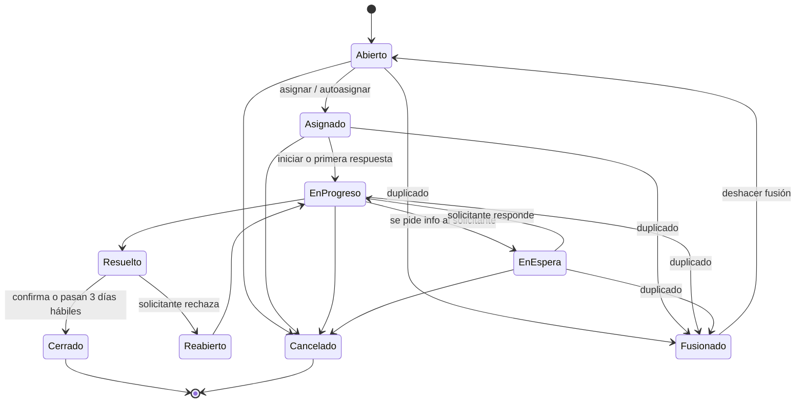
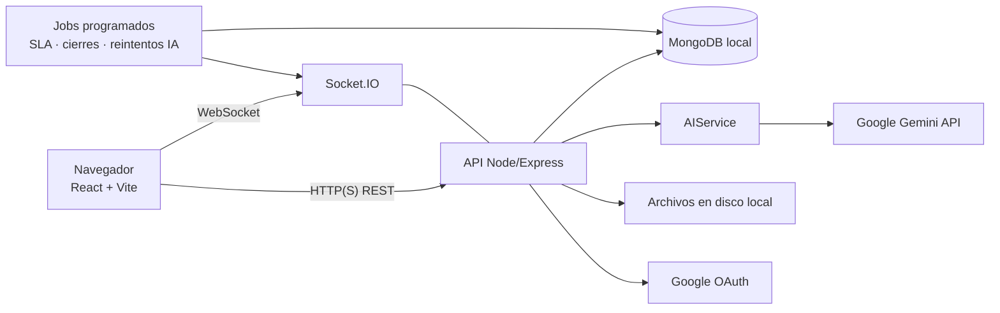
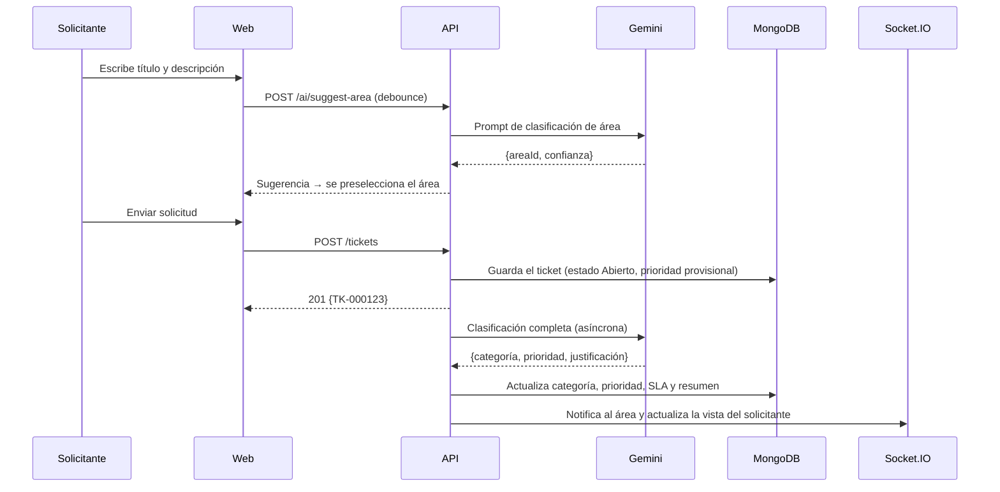

# Tekzaya — Documento de Especificación del Sistema

> **Plataforma web de gestión de tickets de soporte y mantenimiento de activos empresariales, asistida por inteligencia artificial.**

| Campo | Valor |
|---|---|
| Asignatura | Proyecto Emprendedor 2 |
| Versión del documento | 1.4 (lectura de conversaciones por el área, Reportes con gráficas y lista de tickets filtrable, fusión de duplicados, detección de incidentes con IA y tablero sin gráficas) |
| Fecha | 25 de septiembre de 2026 |
| Fase cubierta en detalle | Fase 1: Gestión de tickets de soporte |
| Documento de origen | `tekzaya.md` + imágenes de `ideas_diseno/` |

---

## Índice

1. [Resumen ejecutivo](#1-resumen-ejecutivo)
2. [Contexto del proyecto](#2-contexto-del-proyecto)
3. [Alcance y fases](#3-alcance-y-fases)
4. [Actores, roles y permisos](#4-actores-roles-y-permisos)
5. [Conceptos del dominio: tickets, estados, prioridades y SLA](#5-conceptos-del-dominio)
6. [Inteligencia artificial en Tekzaya](#6-inteligencia-artificial-en-tekzaya)
7. [Fase 1: especificación de pantallas](#7-fase-1-especificación-de-pantallas)
8. [Notificaciones](#8-notificaciones)
9. [Métricas: definiciones y fórmulas](#9-métricas-definiciones-y-fórmulas)
10. [Arquitectura técnica](#10-arquitectura-técnica)
11. [Modelo de datos (MongoDB)](#11-modelo-de-datos-mongodb)
12. [API REST (resumen)](#12-api-rest-resumen)
13. [Requisitos no funcionales](#13-requisitos-no-funcionales)
14. [Fase 2: gestión de mantenimiento (visión)](#14-fase-2-gestión-de-mantenimiento-visión)
15. [Plan de trabajo sugerido](#15-plan-de-trabajo-sugerido)
16. [Riesgos y mitigaciones](#16-riesgos-y-mitigaciones)
17. [Cambios respecto al documento original](#17-cambios-respecto-al-documento-original)
18. [Supuestos y decisiones](#18-supuestos-y-decisiones)
19. [Glosario](#19-glosario)

---

## 1. Resumen ejecutivo

**Tekzaya** es una aplicación web que reúne en un solo lugar dos procesos que en muchas empresas están dispersos entre correos, llamadas, hojas de cálculo y mensajes de chat:

1. **Soporte interno por tickets.** Cualquier empleado reporta una incidencia o solicitud. La IA la clasifica (área destino, categoría y prioridad), el área correspondiente la atiende y el sistema mide tiempos y cumplimiento.
2. **Mantenimiento de activos.** Inventario de equipos, historial de averías, mantenimientos preventivos programados, repuestos y costos.

La **Fase 1** entrega el módulo de tickets completo: autenticación, tableros por rol, listado y creación de tickets (también en nombre de un compañero), conversación con notas públicas e internas (legible por todo el equipo del área), asignación a uno o varios responsables, SLA, notificaciones, encuesta de satisfacción, una sección de **Reportes** donde cada supervisor (y cada empleado, sobre sus propios datos) construye sus gráficas eligiendo qué medir, exportación de reportes y administración de usuarios y áreas. La **Fase 2** añade el módulo de mantenimiento y lo enlaza con los tickets (por ejemplo, un ticket asociado a un equipo concreto).

---

## 2. Contexto del proyecto

> Esta sección es una **propuesta** para el componente emprendedor de la asignatura. Conviene validarla con el docente y con el equipo.

### 2.1 Problema

- Las solicitudes internas llegan por muchos canales (correo, WhatsApp, pasillo) y **se pierden o se duplican**.
- No hay **prioridad objetiva**: se atiende primero a quien insiste más, no lo más crítico.
- Los supervisores **no pueden medir** carga de trabajo, tiempos de respuesta ni desempeño de su equipo.
- El conocimiento de cómo se resolvió un problema **no queda registrado**.
- El mantenimiento de equipos suele ser **reactivo**: se repara cuando falla, sin historial ni costos consolidados.

### 2.2 Propuesta de valor

| Para… | Tekzaya ofrece… |
|---|---|
| Empleados | Un único lugar para pedir ayuda y ver el estado de su solicitud sin tener que preguntar. |
| Técnicos / miembros de área | Tickets ya clasificados y resumidos por IA y autocompletado de respuestas. |
| Supervisores | Visibilidad de la carga de cada persona, asignación informada y métricas del área. |
| Dirección / RRHH | Indicadores globales de servicio y desempeño por área y persona. |

### 2.3 Público objetivo

Pequeñas y medianas empresas (pymes) de habla hispana, de 20 a 500 empleados, sin una mesa de ayuda formal o que usan herramientas genéricas.

### 2.4 Competencia de referencia

| Herramienta | Observación |
|---|---|
| Jira Service Management, Zendesk, Freshdesk | Completas pero caras y complejas para una pyme; orientadas a soporte de clientes externos. |
| GLPI, osTicket | Gratuitas y de código abierto, pero con una interfaz anticuada y sin IA integrada. |
| **Tekzaya (diferenciador)** | Interfaz moderna en español, IA integrada desde el primer ticket, y **soporte + mantenimiento de activos en una sola herramienta**. |

---

## 3. Alcance y fases

### 3.1 Decisiones de alcance

| Decisión | Valor acordado |
|---|---|
| Tipo de despliegue | **Una sola empresa** (instancia única). El modo multiempresa (SaaS) queda como evolución futura. |
| Idioma de la interfaz | Español. |
| Dispositivos | Web responsiva (escritorio como prioridad; tablet y móvil funcionales). |
| Entorno de ejecución | **Local** por ahora (equipo de desarrollo o servidor de la empresa). El despliegue en la nube queda como evolución futura. |
| Marca | Nombre **Tekzaya**; paleta azul-morado (ver la [sección 7.0](#70-estructura-general-layout)). El logo está pendiente; mientras tanto se usa un logotipo tipográfico provisional. |

### 3.2 Fase 1: gestión de tickets (entregable principal)

**Incluye:**
- Inicio de sesión con Google y con correo y contraseña.
- Tableros (dashboard) por rol: empleado, supervisor de área, supervisor de RRHH y administrador. Son **sin gráficas**: 4 tarjetas KPI, los 3 primeros tickets asignados al usuario y sus últimas solicitudes; las gráficas están en Reportes.
- Listado de tickets en tres vistas: **lista**, **agrupada** y **Kanban**.
- Creación de tickets con departamento sugerido por IA, también **en nombre de un compañero de la misma área**.
- Detalle del ticket con conversación, **notas públicas e internas**, autocompletado con IA (tecla Tab) y resumen automático. **Cualquier compañero del área destino puede leer la conversación completa** de los tickets de su área, aunque no sea responsable.
- Asignación por supervisor (con visión de carga) y autoasignación; un ticket puede tener **varios responsables**.
- Indicador de **disponibilidad** (disponible / ausente) de cada persona.
- **Fusión de tickets duplicados** dentro de un área, con ticket principal, historial y opción de deshacer.
- **Reportes personalizables** (sección propia, ver [7.8](#78-reportes)): el usuario elige alcance, período, medidas, agrupación y tipo de gráfica. Supervisores de área → su área; administrador y supervisor de RRHH → todas las áreas; empleados → solo sus propios datos.
- **Exportación de reportes** en CSV y PDF.
- Estados, prioridades y **SLA** con alertas de vencimiento.
- Notificaciones dentro de la aplicación, en tiempo real.
- **Encuesta de satisfacción** (CSAT) al resolver.
- **Administración** de usuarios, áreas, categorías y SLA.

**No incluye (queda para fases posteriores):**
- Módulo de mantenimiento y activos (Fase 2).
- Notificaciones por correo electrónico.
- Base de conocimientos (artículos de solución).
- Sugerencias de solución generadas por IA (se descartan para ahorrar cuota de tokens).
- Aplicación móvil nativa.
- Multiempresa y planes de suscripción.
- Despliegue en la nube.

### 3.3 Fase 2: mantenimiento de activos

Descrita a nivel de visión en la [sección 14](#14-fase-2-gestión-de-mantenimiento-visión).

---

## 4. Actores, roles y permisos

### 4.1 Principio básico

**Todo empleado pertenece a un área, y todo miembro de un área puede atender los tickets dirigidos a ella.** Por lo tanto, un mismo usuario tiene dos facetas:

- **Solicitante:** crea tickets hacia cualquier área, incluida la suya.
- **Agente de su área:** ve, toma y resuelve los tickets que llegan a su área.

Por eso el tablero del empleado muestra "tickets resueltos por mí" y "tickets pendientes para mí".

**Transparencia dentro del área:** como el trabajo es de todo el equipo, **cualquier miembro de un área puede leer la conversación completa (mensajes públicos y notas internas) de cualquier ticket dirigido a su área**, esté o no asignado a él. Así puede cubrir a un compañero ausente, aprender de casos anteriores o retomar un ticket sin preguntar. Leer no implica actuar: responder públicamente al solicitante sigue reservado a los responsables del ticket y a los supervisores (ver [7.5](#75-detalle-del-ticket-y-conversación)).

### 4.2 Roles

| Rol | Descripción |
|---|---|
| **Empleado** | Rol base. Crea tickets, da seguimiento a sus solicitudes, atiende los tickets de su área (se autoasigna o recibe asignaciones), lee las conversaciones de todos los tickets de su área y genera **reportes solo sobre sus propios datos**. |
| **Supervisor de área** | Empleado con permisos adicionales sobre **su área**: asigna y reasigna tickets, cambia prioridades, ve las estadísticas del área y genera **reportes de su área** (del área completa, de una persona del área o suyos). Puede haber uno o más supervisores por área. |
| **Supervisor de RRHH** | Supervisor de su propia área (RRHH) **más una vista global de solo lectura** de las estadísticas de todas las áreas y personas, y puede **generar reportes de todas las áreas**. No configura el sistema, no gestiona usuarios y no asigna tickets de otras áreas. |
| **Administrador** | Control total: gestiona usuarios, áreas, categorías, SLA y configuración; ve estadísticas globales y **genera reportes de todas las áreas**; puede asignar o reasignar cualquier ticket. |

> **Implementación sugerida:** en lugar de un único campo "rol", conviene guardar
> `role: "employee" | "admin"`, `areaId`, `isAreaSupervisor: boolean` y `hasGlobalReadAccess: boolean` (para RRHH).
> Así se pueden combinar permisos sin crear roles duplicados.

### 4.3 Matriz de permisos (Fase 1)

| Acción | Empleado | Supervisor de área | Supervisor de RRHH | Admin |
|---|:-:|:-:|:-:|:-:|
| Crear ticket (hacia cualquier área) | ✅ | ✅ | ✅ | ✅ |
| Crear ticket en nombre de otra persona | ✅ (compañero de su área) | ✅ (compañero de su área) | ✅ (compañero de su área) | ✅ (cualquiera) |
| Ver y responder sus propios tickets (como solicitante o como creador) | ✅ | ✅ | ✅ | ✅ |
| Cambiar la categoría de su propio ticket (si no está resuelto) | ✅ | ✅ | ✅ | ✅ |
| Ver los tickets dirigidos a su área | ✅ | ✅ | ✅ (su área) | ✅ (todas) |
| **Leer la conversación completa** (mensajes públicos y notas internas) de cualquier ticket de su área, aunque no sea responsable | ✅ | ✅ | ✅ (su área) | ✅ (todas) |
| Responder públicamente al solicitante | ✅ solo si es responsable | ✅ (su área) | ✅ (su área; en otras solo si es responsable) | ✅ |
| Autoasignarse un ticket de su área | ✅ | ✅ | ✅ | ✅ |
| Asignar, añadir o quitar responsables | ❌ | ✅ (su área) | ✅ (solo su área) | ✅ |
| Cambiar la categoría de un ticket del área | ❌ | ✅ (su área) | ✅ (su área) | ✅ |
| Marcarse como disponible / ausente | ✅ | ✅ | ✅ | ✅ |
| Marcar como ausente a otra persona | ❌ | ✅ (su área) | ✅ (su área) | ✅ |
| Exportar reportes (CSV / PDF) | ✅ (sus datos) | ✅ (su área) | ✅ (todas) | ✅ (todas) |
| Escribir y ver notas internas | ✅ (su área) | ✅ (su área) | ✅ (su área) | ✅ |
| Cambiar la prioridad sugerida por la IA | ❌ | ✅ (su área) | ✅ (su área) | ✅ |
| Transferir un ticket a otra área | ✅ si está asignado a él | ✅ | ✅ (su área) | ✅ |
| Cambiar el estado de un ticket asignado a él | ✅ | ✅ | ✅ | ✅ |
| Cancelar su propio ticket (si no está resuelto) | ✅ | ✅ | ✅ | ✅ |
| **Fusionar tickets duplicados** (misma área) y deshacer la fusión | ✅ solo si es responsable de ambos; puede *sugerirlo* si no lo es | ✅ (su área) | ✅ (su área) | ✅ (todas) |
| Tablero personal | ✅ | ✅ | ✅ | ✅ |
| **Sección Reportes: gráficas personalizadas, lista de tickets con filtros, guardar y exportar** | ✅ (gráficas solo de sus datos; lista de tickets de todo su área) | ✅ (su área, una persona de su área o sus datos) | ✅ (todas las áreas, cualquier persona o sus datos) | ✅ (todas las áreas, cualquier persona o sus datos) |
| Tablero de área | ❌ | ✅ (su área) | ✅ (todas, solo lectura) | ✅ (todas) |
| Estadísticas de una persona concreta | ❌ | ✅ (de su área) | ✅ (cualquiera) | ✅ (cualquiera) |
| Gestionar usuarios, áreas, categorías y SLA | ❌ | ❌ | ❌ | ✅ |

**Regla de privacidad:** un solicitante **nunca** ve las notas internas, aunque pertenezca al área que atiende otro ticket suyo. Solo las ve cuando actúa como agente del área destino. La misma regla vale para la lectura de conversaciones del área: si el ticket es **suyo** (como solicitante o como creador), no ve las notas internas de ese ticket, aunque pertenezca al área destino.

---

## 5. Conceptos del dominio

### 5.1 Anatomía de un ticket

| Campo | Origen | Notas |
|---|---|---|
| Número (`TK-000123`) | Sistema | Secuencial, legible; distinto del `_id` interno. |
| Título | Solicitante | Obligatorio, de 5 a 120 caracteres. |
| Descripción | Solicitante | Obligatoria, de 10 a 5000 caracteres. |
| Adjuntos | Solicitante / agentes | Hasta 5 archivos por mensaje, 10 MB cada uno. Formatos: PNG, JPG, PDF, TXT, LOG, DOCX, XLSX. |
| Área destino | IA sugiere, el solicitante confirma | Editable por el solicitante antes de enviar. |
| Categoría | IA sugiere; el solicitante puede cambiarla | Depende del área (por ejemplo, IT → "Redes y conectividad"). El solicitante (y el supervisor o el admin) puede cambiarla mientras el ticket no esté Resuelto, Cerrado o Cancelado; el cambio queda en el historial. |
| Prioridad | IA | Editable solo por el supervisor o el admin, con motivo obligatorio. |
| Solicitante | Usuario o sistema | Persona afectada por el problema. Por defecto es quien crea el ticket, pero un compañero de **su misma área** puede crearlo en su nombre (por ejemplo, si al solicitante se le dañó el equipo o no tiene sus credenciales a mano). |
| Creado por | Sistema | Usuario que registró el ticket. Solo se muestra si es distinto del solicitante (*"Creado por Ana en nombre de Luis"*). |
| Responsables | Supervisor, admin o autoasignación | **Una o varias personas** del área destino. El solicitante puede ver quiénes son. |
| Estado | Sistema y agentes | Ver la [sección 5.2](#52-estados-y-ciclo-de-vida). |
| Fechas clave | Sistema | Creación, primera respuesta, resolución, cierre y vencimientos de SLA. |
| Resumen de IA | IA | Se regenera cuando la conversación cambia de forma significativa. |
| Calificación CSAT | Solicitante | De 1 a 5, con comentario opcional. |

### 5.2 Estados y ciclo de vida

| Estado | Significado | ¿Quién lo pone? |
|---|---|---|
| **Abierto** | Creado, sin responsable. | Sistema, al crear el ticket. |
| **Asignado** | Tiene responsable, pero aún no se empezó a trabajar. | Sistema, al asignar. |
| **En progreso** | El responsable está trabajando en él. | Agente (o automático con su primera respuesta pública). |
| **En espera** | Se necesita información o una acción del solicitante. **El reloj del SLA se pausa.** | Agente. |
| **Resuelto** | El agente considera que el problema quedó solucionado. Se envía la encuesta CSAT. | Agente. |
| **Cerrado** | Estado final. El solicitante confirma la solución, o el ticket se cierra solo tras **3 días hábiles** en "Resuelto" (valor configurable). | Solicitante o sistema. |
| **Reabierto** | El solicitante indica que no se resolvió (solo mientras está en "Resuelto"). Vuelve a los mismos responsables. | Solicitante. |
| **Cancelado** | El solicitante retira la solicitud, o un supervisor la descarta (improcedente). Requiere motivo. | Solicitante o supervisor. |
| **Fusionado** | El ticket era un **duplicado** de otro y se unió al ticket principal. Es un estado final: el trabajo continúa en el principal (ver [7.5.1](#751-fusionar-tickets-duplicados)). Se puede deshacer. | Responsable, supervisor o admin, con la acción "Fusionar". |



**Reglas adicionales:**
- Si el solicitante responde mientras el ticket está **En espera**, el estado vuelve automáticamente a **En progreso**.
- Si pasan **5 días hábiles** en "En espera" sin respuesta del solicitante, se le recuerda; a los 10 días se puede cerrar automáticamente (configurable).
- Con **varios responsables**, cualquiera de ellos puede cambiar el estado; el ticket tiene un solo estado compartido.
- **Transferir** a otra área devuelve el ticket a "Abierto" en el área nueva, sin responsables, y queda registrado en el historial (sirve también para medir los errores de clasificación de la IA).

### 5.3 Prioridades y SLA

La IA asigna la prioridad al crear el ticket. Los tiempos se miden en **horario laboral** (por defecto de lunes a viernes, de 08:00 a 18:00, configurable) **para todas las prioridades, incluida "Urgente"**.

| Prioridad | Criterio orientativo (lo usa la IA) | 1.ª respuesta | Resolución |
|---|---|---|---|
| 🔴 **Urgente** | Paraliza la operación o afecta a muchas personas; riesgo de seguridad o económico inmediato. | 15 min | 4 h |
| 🟠 **Alta** | Impide trabajar a una persona o equipo, sin alternativa. | 1 h | 8 h |
| 🟡 **Media** | Afecta el trabajo pero existe una alternativa temporal. | 4 h | 24 h |
| 🟢 **Baja** | Consultas, solicitudes planificables, mejoras. | 8 h | 72 h |

> **Decidido:** el SLA "Urgente" **no** corre 24/7; se mide en horario laboral como el resto, porque la Fase 1 no contempla guardias.

**Estados de SLA de un ticket:** `En tiempo` → `En riesgo` (se consumió el 75 % del tiempo) → `Vencido`. Se muestran con color en la lista y generan notificaciones (ver la [sección 8](#8-notificaciones)).

Los tiempos de la tabla son **valores iniciales editables por el administrador**.

### 5.4 Áreas y categorías iniciales (datos semilla)

| Área | Categorías de ejemplo |
|---|---|
| IT y Sistemas | Hardware, Software, Redes y conectividad, Accesos y cuentas, Correo, Impresoras |
| Mantenimiento | Eléctrico, Plomería, Climatización, Mobiliario, Limpieza |
| Recursos Humanos | Nómina, Vacaciones y permisos, Documentos y constancias, Beneficios |
| Ventas | Cotizaciones, Clientes, Comisiones |
| Marketing | Material gráfico, Redes sociales, Eventos |
| Finanzas | Reembolsos, Pagos a proveedores, Facturación |

El administrador puede crear, editar y desactivar áreas y categorías. **Un área solo puede recibir tickets si tiene al menos un miembro activo.**

---

## 6. Inteligencia artificial en Tekzaya

### 6.1 Proveedor

- **Google Gemini API, plan gratuito**, con un modelo de la familia *Flash* por su velocidad y bajo costo.
- Todas las llamadas pasan por un **servicio interno `AIService`** en el backend, con una interfaz propia. Así se puede cambiar de proveedor (Groq, Ollama o un plan de pago) sin tocar el resto del sistema.
- La clave de API vive **solo en el backend**, nunca en el navegador.

> ⚠️ **Advertencia importante sobre el plan gratuito:** en el plan gratuito de Gemini, Google puede usar el contenido enviado para mejorar sus productos, y los límites de uso (peticiones por minuto y por día) son bajos y pueden cambiar. Para el prototipo académico es aceptable, pero:
> - **No se deben enviar datos sensibles reales** (contraseñas, datos personales, datos de clientes).
> - En producción habría que pasar a un plan de pago o a un modelo local.
> - Conviene revisar los términos y límites vigentes en la documentación oficial antes de empezar.

### 6.2 Funciones de IA en la Fase 1

| # | Función | Cuándo se ejecuta | Entrada | Salida |
|---|---|---|---|---|
| IA-1 | **Sugerencia de área** | Mientras el usuario escribe el título y la descripción (con *debounce* de ~800 ms y un mínimo de 20 caracteres). | Título + descripción + lista de áreas activas. | Área sugerida + confianza (0 a 1). |
| IA-2 | **Clasificación completa** | Al enviar el ticket (de forma asíncrona). | Título, descripción, área elegida y categorías del área. | Categoría, prioridad, justificación breve y confianza. |
| IA-3 | **Resumen automático** | Al crear el ticket y cada vez que se añaden 3 mensajes nuevos, o a petición ("Regenerar"). | Descripción + conversación (incluidas las notas internas; solo lo ven los agentes). | Resumen de 3 a 5 líneas: problema, lo intentado y el estado actual. |
| IA-4 | **Autocompletado con Tab** | Mientras el agente escribe una respuesta, tras una pausa de ~600 ms. | Contexto del ticket + texto parcial. | Continuación en texto gris ("ghost text"); **Tab** la acepta y **Esc** la descarta. |
| IA-5 | **Detección de incidentes** | Al terminar la clasificación (IA-2) de un ticket nuevo, **solo si** hay al menos 2 tickets recientes parecidos en la misma área (ver abajo). | Título, categoría y descripción breve del ticket nuevo + los de hasta 10 candidatos (sin notas internas). | Si el ticket forma parte de un grupo de **3 o más tickets sobre el mismo problema**: una **etiqueta de incidente** (por ejemplo, *"Caída del wifi en Ventas"*), la lista de tickets del grupo y la confianza (0 a 1). |

> **La detección de duplicados individuales NO usa IA.** Buscar y fusionar duplicados es manual, con ayuda de una búsqueda de texto (ver [7.5.1](#751-fusionar-tickets-duplicados)). La IA solo interviene para detectar **incidentes** (un mismo problema reportado muchas veces).

**Cómo funciona IA-5**
1. **Preselección barata, sin IA:** se buscan en el **mismo área** los tickets no finalizados de las últimas 48 h (configurable) que comparten categoría o palabras del título (índice de texto). Si hay menos de 2 candidatos, **no se llama a Gemini** (ahorra cuota).
2. **Una sola llamada** a Gemini con el ticket nuevo y los candidatos, con salida JSON validada. La IA decide cuáles describen el mismo problema; si con el ticket nuevo suman **3 o más** (configurable), hay incidente.
3. **Si hay incidente** (confianza de 60 % o más):
   - Se avisa a los **supervisores del área** (*"Posible incidente: 4 tickets sobre la caída del wifi en Ventas"*).
   - Los tickets del grupo reciben una **etiqueta de incidente** visible para los agentes en la lista y el detalle. Los solicitantes no la ven.
   - Se **sugiere subir la prioridad** (decide el supervisor).
   - Desde el aviso, el supervisor puede abrir **"Ver tickets del incidente"** y, si lo decide, **"Fusionar…"**, que abre el modal de fusión con los tickets del grupo marcados. **La IA nunca fusiona por sí sola.**
4. El supervisor puede pulsar **"No es un incidente"** para quitar la etiqueta; la IA no vuelve a agrupar esos tickets.
5. Si llegan más tickets del mismo problema, se **suman al incidente existente** y se actualiza el contador.
6. Se guarda cada detección y su resultado (confirmada, descartada) para medir la **precisión de la detección de incidentes** (sección 9).

> **Descartado:** las *sugerencias de solución* generadas por IA (pasos recomendados y tickets similares) se eliminaron del alcance para no consumir tantos tokens de la cuota gratuita.

**Formato:** las funciones IA-1, IA-2 e IA-5 deben pedir al modelo **salida JSON estructurada** (con un esquema definido) y validarla en el backend antes de guardarla.

### 6.3 Reglas de robustez

- **La IA nunca bloquea el flujo.** Si Gemini falla, excede la cuota o responde algo inválido:
  - El ticket se crea igual, con el área elegida por el usuario, prioridad **Media** y la etiqueta *"Pendiente de clasificación"*. Un reintento en segundo plano vuelve a intentarlo.
  - El autocompletado y el resumen simplemente no aparecen.
  - Si falla IA-5, simplemente no se detectan incidentes automáticamente; la fusión manual no depende de la IA.
- **Cuotas:** limitar el autocompletado por usuario (por ejemplo, 1 petición cada 2 s) y guardar en caché los resúmenes para no gastar la cuota gratuita.
- **Trazabilidad:** guardar en el ticket qué sugirió la IA (área, prioridad y confianza) y qué se decidió finalmente. Esto permite mostrar la **precisión de la IA** como métrica del proyecto, que además es un buen dato para la defensa.
- **Prompt injection:** el texto del usuario se trata como datos, no como instrucciones. Se delimita en el prompt y la salida siempre se valida contra el esquema.

---

## 7. Fase 1: especificación de pantallas

### 7.0 Estructura general (layout)

Basada en `crear_ticket.png` y `crear_ticket2.png`:

- **Barra lateral izquierda:** logo de Tekzaya (provisional) · Tablero · Tickets (con contador) · *Activos y mantenimiento (deshabilitado, con la etiqueta "Próximamente")* · Reportes (**todos los roles**; el alcance de los datos depende del rol, ver [7.8](#78-reportes)) · sección **Administración** (solo admin): Usuarios, Áreas y categorías, Configuración.
- **Barra superior:** buscador global (tickets por número o título) · botón **"+ Nuevo ticket"** siempre visible · campana de notificaciones con contador · selector de tema claro/oscuro · avatar con nombre, área, rol e **indicador de disponibilidad** (punto verde = disponible, gris = ausente), y menú (perfil, cambiar disponibilidad, cerrar sesión).
- **Estilo visual:** limpio, con tarjetas blancas de bordes redondeados sobre un fondo gris claro, la paleta de marca azul-morado y colores semánticos consistentes para prioridad y estado.

**Paleta de marca (propuesta):**

| Token | Color | Uso |
|---|---|---|
| `brand-primary` | `#4F46E5` (índigo) | Botones principales, enlaces, elementos activos de la barra lateral. |
| `brand-secondary` | `#7C3AED` (violeta) | Acentos, etiquetas de IA (✨), gráficas secundarias. |
| `brand-gradient` | `#2563EB` → `#7C3AED` | Panel del login, logotipo, cabeceras destacadas. |
| `brand-soft` | `#EEF2FF` | Fondos suaves de selección y tarjetas de sugerencia de IA. |
| Fondo (claro / oscuro) | `#F8FAFC` / `#0F172A` | Fondo general de la aplicación. |

Los colores semánticos de prioridad (rojo, naranja, amarillo, verde) y de SLA se mantienen independientes de la marca para que no se confundan con ella.

**Logo:** pendiente de diseño. Mientras tanto se usa un logotipo tipográfico: la palabra **Tekzaya** con el degradado de marca y, como icono, una **"T"** blanca dentro de un cuadrado redondeado con el mismo degradado (sirve también de favicon).

### 7.1 Login

**Objetivo:** atractivo y con poco texto.

**Diseño:**
- Pantalla dividida: a la izquierda una ilustración sobre el degradado de marca azul-morado con el logo y un eslogan corto (por ejemplo, *"Soporte y mantenimiento, en un solo lugar."*); a la derecha el formulario.
- Botón principal: **"Continuar con Google"**.
- Separador "o".
- Campos de correo y contraseña, botón "Iniciar sesión" y enlace "¿Olvidaste tu contraseña?".
- En móvil se muestra solo el formulario.

**Reglas:**
- **No hay registro público.** Como es una sola empresa, **el administrador invita a los usuarios** (se les asigna área y rol). Al aceptar la invitación, el usuario define su contraseña o entra directamente con Google.
- El inicio de sesión con Google solo funciona si el correo **ya está registrado** o pertenece al **dominio corporativo permitido** (configurable, por ejemplo `@empresa.com`). Un correo desconocido recibe el mensaje *"Tu cuenta no está habilitada. Contacta al administrador."*
- Contraseñas: mínimo 8 caracteres, con letras y números; se guardan con hash **bcrypt**.
- Bloqueo temporal tras 5 intentos fallidos (15 min).
- Sesión: *access token* JWT de corta duración (15 min) y *refresh token* en una cookie `httpOnly` (7 días).
- Recuperación de contraseña: en la Fase 1 no se envía correo, así que **el administrador genera un enlace de restablecimiento** desde la gestión de usuarios. Quedará automatizado cuando se agregue el correo.

### 7.2 Tablero (dashboard)

Es la primera pantalla después del login. Encabezado con saludo (*"Hola, Andrés 👋"*) y una frase de atención (*"Tienes 3 tickets que requieren tu atención"*), como en `ticket_lista.png`.

**El tablero es una vista rápida, sin gráficas.** Muestra únicamente **4 tarjetas de indicadores (KPI)** y listas cortas de tickets sobre los que actuar. Todas las gráficas (resueltos por persona, tiempos, solicitudes por categoría, evolución en el tiempo…) viven en la sección [Reportes](#78-reportes), donde además se pueden personalizar.

**Filtro de período (solo para las tarjetas KPI):** `Día | Semana | Mes | Año`, más un **rango personalizado**. Las listas de tickets no dependen del período: siempre muestran el estado actual.

#### 7.2.1 Tablero del empleado (vista personal)

**Fila superior: 4 tarjetas de indicadores (KPI)**

| Tarjeta | Definición exacta |
|---|---|
| Pendientes del área | Tickets de **mi área** en un estado distinto de Resuelto, Cerrado, Cancelado o Fusionado. |
| Resueltos por mí | Tickets que **yo** resolví en el período seleccionado. |
| Pendientes para mí | Tickets donde **soy uno de los responsables** que aún no están resueltos. |
| Urgentes | Tickets con prioridad **Urgente** sin resolver, **donde soy responsable o sin asignar en mi área**. |

> ✏️ **Ajuste respecto al original:** "total de tickets pendientes" era ambiguo. Se interpretó como los **pendientes del área**, porque "pendientes para mí" ya cubre los personales. Hay que confirmarlo.

Cada tarjeta es **clicable** y lleva a la lista de tickets con el filtro correspondiente aplicado. Opcionalmente puede mostrar la variación respecto al período anterior (por ejemplo, "+8 % vs. semana pasada"), como en `dashboard.webp`.

**Zona inferior: dos paneles de tickets (sin gráficas)**

- **Izquierda: panel "Asignados a mí"**, con los **3 primeros tickets asignados a mí** que siguen sin resolver. Orden: primero los que tienen una **respuesta nueva del solicitante**, luego los de SLA vencido o en riesgo, luego por prioridad y antigüedad. Cada fila muestra:
  1. `TK-000123 · Título`, prioridad, estado y el **tiempo restante del SLA** con color (verde, ámbar o rojo).
  2. **Si el solicitante respondió** desde mi última acción: avatar y nombre del solicitante, un fragmento de su mensaje (2 líneas), la etiqueta *"Respondió el solicitante"* y un punto azul mientras no lo abra. Si el ticket estaba **En espera**, vuelve a **En progreso** y se destaca con *"Te respondieron"*.
  3. **Si no hay novedades:** solo los datos de la primera línea.
  - Al hacer clic se abre el detalle del ticket, listo para leer y responder.
  - **Sin tickets asignados:** estado vacío con el texto *"No tienes tickets asignados"* y el botón **"Ver tickets de mi área"** (para tomar uno).
  - Enlace al pie: *"Ver todos los asignados a mí"* (lista de tickets, pestaña "Asignados a mí").
- **Derecha: panel "Mis solicitudes"**, con los **5 tickets más recientes que creé**, ordenados por última actividad. Incluye los que creé para mí y los que **creé en nombre de un compañero**:
  1. **Sin respuesta:** `TK-000123 · Título` + etiqueta gris *"Sin respuesta"*.
  2. **Con respuesta del área:** `TK-000123 · Título` + avatar y nombre de quien respondió + un fragmento de la última respuesta pública (2 líneas) + un punto azul si hay respuestas no leídas.
  3. **Con respuesta del solicitante:** si el ticket lo creé en nombre de otra persona y **esa persona (el solicitante) respondió**, se muestra igual, con la etiqueta *"Respondió [nombre]"* y el punto azul, para que yo también me entere.
  4. **Sin tickets:** un estado vacío amigable con ilustración, el texto *"Aún no has creado solicitudes"* y el botón **"Crear mi primer ticket"**.
  - Al hacer clic se abre el detalle del ticket, listo para leer y responder.
  - Enlace al pie: *"Ver todas mis solicitudes"*.

> ✏️ **Mejora:** también se muestra el **estado** de cada solicitud (En progreso, En espera…), y si el ticket está **En espera** se destaca con *"Necesita tu respuesta"*, porque es la acción más importante para el solicitante.

En pantallas pequeñas, las tarjetas se apilan en 2×2 y los dos paneles pasan uno debajo del otro.

#### 7.2.2 Tablero del supervisor de área

Un **interruptor** en la parte superior: `Mi área (predeterminado) | Personal`. La vista **Personal** es idéntica a la del empleado (4 tarjetas + "Asignados a mí" + "Mis solicitudes").

**Vista "Mi área": 4 tarjetas KPI**

| Tarjeta | Definición |
|---|---|
| Tickets pendientes | Tickets del área sin resolver (y cuántos están **sin asignar**). |
| Tickets resueltos | Resueltos por el área en el período. |
| Tiempo medio de primera respuesta | Promedio del período, en horas laborales; con color según el SLA. |
| Cumplimiento de SLA / CSAT | % de tickets resueltos dentro del SLA y satisfacción media (1-5). |

**Disponibilidad del equipo:** debajo de las tarjetas, un panel de lista compacta muestra quién está **ausente** en este momento (y hasta cuándo), para que el supervisor lo tenga en cuenta al repartir trabajo. Si hay un **incidente** detectado por la IA (ver 6.2), aparece aquí una franja de aviso con enlace a los tickets del grupo.

**Dónde están las gráficas:** las que antes mostraba el tablero (tickets resueltos por persona, tiempo medio de respuesta por persona, solicitudes por categoría y recibidos frente a resueltos en el tiempo) ahora son la **plantilla "Rendimiento del equipo"** de Reportes, accesible con un enlace *"Ver gráficas en Reportes"* desde el tablero.

**Restricción:** el supervisor **solo** ve las estadísticas de su área. El backend lo valida en cada consulta; no basta con ocultarlo en la interfaz.

#### 7.2.3 Tablero del administrador y del supervisor de RRHH

Las mismas 4 tarjetas que el tablero de área, más un **selector de alcance**:

`Todas las áreas | Área: [seleccionar] | Persona: [buscar] | Yo`

- **Todas las áreas:** las KPI son globales; el panel inferior muestra la **disponibilidad** de todas las áreas y los incidentes activos.
- **Área concreta:** es igual al tablero de ese supervisor.
- **Persona concreta:** son las 4 tarjetas personales de esa persona (solo lectura).
- **Yo:** su propio tablero personal (con "Asignados a mí" y "Mis solicitudes").

El supervisor de RRHH tiene esta vista **en solo lectura**: puede ver, pero no reasignar ni configurar nada fuera de su área.

#### 7.2.4 Exportación de reportes

Todos los tableros tienen un botón **"Exportar ▾"** con dos opciones, que respetan el alcance (persona, área o global) y el período seleccionados:

| Formato | Contenido | Generación |
|---|---|---|
| **CSV** | Datos tabulares: KPI del período y el listado de tickets del período con sus campos principales (número, título, área, categoría, prioridad, estado, solicitante, responsables, fechas y tiempos de SLA, CSAT). | En el backend, a partir de las mismas consultas de la lista de tickets de Reportes. Codificación UTF-8 con BOM para que Excel muestre bien los acentos. |
| **PDF** | Informe de una página: encabezado con el logo, alcance y período; las 4 tarjetas KPI y la tabla de tickets más relevantes. Para un informe con gráficas se usa la exportación de la sección Reportes. | En el navegador, a partir de la vista del tablero (por ejemplo, con `html2canvas` + `jsPDF`). |

Los reportes personalizados y la lista de tickets de la sección [Reportes](#78-reportes) se exportan con las mismas reglas (CSV desde el backend, PDF desde el navegador).

Además, la **lista de tickets** tiene un botón **"Exportar CSV"** que descarga los tickets que coinciden con los filtros actuales.

**Permisos:** solo se exporta lo que el usuario puede ver en pantalla (el backend aplica las mismas reglas que en las estadísticas). Las exportaciones **nunca** incluyen el contenido de las notas internas.

### 7.3 Tickets (listado)

**Pestañas rápidas** en la parte superior (inspiradas en `ticket_groups.webp`), cada una con su contador:

`Mis solicitudes | Asignados a mí | Mi área | Sin asignar` (+ `Todos` para el admin)

**Barra de herramientas:** buscador (número o título) · filtros (estado, prioridad, área, categoría, responsable, solicitante, estado de SLA y rango de fechas) · selector de vista `Lista | Grupos | Kanban` · ordenar por · **Exportar CSV**.

La pestaña "Mis solicitudes" incluye los tickets donde soy el solicitante **y** los que creé en nombre de otra persona.

En las pestañas **"Mi área"** y **"Sin asignar"**, cualquier miembro del área puede abrir un ticket y leer su conversación completa sin necesidad de asignárselo (ver [7.5](#75-detalle-del-ticket-y-conversación)). Una pequeña etiqueta *"Solo lectura"* indica los tickets en los que la persona no es responsable.

#### Columnas de la vista Lista

| Columna | Detalle |
|---|---|
| ☐ | Selección múltiple para acciones en lote (supervisor: asignar, cambiar prioridad). |
| ID | `TK-000123` |
| Título | Truncado, con tooltip; 📎 si tiene adjuntos. |
| Solicitante | Avatar + nombre corto (con un icono si otra persona lo creó en su nombre). |
| Área / categoría | Etiqueta pequeña (útil en las pestañas "Mis solicitudes" y "Todos"). |
| Prioridad | Barra de color + texto (como en `ticket_lista.png`). |
| Responsables | Avatares apilados (máximo 3 visibles y "+N"; tooltip con los nombres), o botón **"Asignar"** (supervisor) / **"Tomar"** (miembro del área) si está vacío. |
| Estado | Etiqueta de color. |
| T. respuesta | Tiempo hasta la primera respuesta; si aún no hay respuesta, el tiempo restante del SLA con color (verde, ámbar o rojo). |
| T. resolución | Tiempo hasta la resolución; si está abierto, el tiempo restante del SLA. |
| Creado | Si es **de hoy**: *"hace 12 min"* o *"hace 3 h"*. Si es de otro día: `12 ene 2026, 09:14`. Tooltip con la fecha completa. |

**Orden predeterminado:** primero los que tienen el SLA vencido o en riesgo, luego por prioridad y luego por antigüedad.

**Paginación:** 25 filas por página (configurable a 50 o 100).

#### Vista Grupos

Las mismas filas, agrupadas en secciones plegables con contador. Se agrupa por: **Estado** (predeterminado), Prioridad, Responsable, Categoría o Área. Al agrupar por responsable, un ticket con varios responsables aparece en el grupo de cada uno.

#### Vista Kanban

- Una columna por estado activo: Abierto · Asignado · En progreso · En espera · Resuelto (Cerrado, Cancelado y Fusionado quedan ocultos por defecto).
- Tarjetas como en `ticket_groups.webp`: prioridad, título, categoría, barras de SLA de respuesta y resolución, solicitante y número.
- **Arrastrar y soltar** cambia el estado, **solo si la transición es válida** y el usuario tiene permiso. Si no lo es, la tarjeta vuelve a su sitio con un aviso.
- Al soltar en "En espera" o "Resuelto" se pide un comentario breve (opcional para En espera y obligatorio para Resuelto: la nota de solución).

### 7.4 Crear ticket

Se abre con **"+ Nuevo ticket"** desde cualquier pantalla, como página propia (o como panel lateral amplio). Debe ser **conciso**: solo 4 campos.

**Formulario (columna izquierda):**

0. **Solicitante** — por defecto *"Yo"*. Un enlace discreto **"Crear en nombre de un compañero"** muestra un buscador con los miembros activos **de mi área** (el admin puede elegir a cualquier persona). Pensado para cuando al compañero se le dañó el equipo o no tiene sus credenciales a mano. No cuenta como campo adicional para quien crea sus propios tickets.
1. **Título / asunto** \* — con contador `64/120` y ayuda: *"Resume el problema en una frase."*
2. **Descripción** \* — área de texto amplia; indicador *"✨ IA analizando…"* mientras se procesa.
3. **Departamento de destino** \* — un selector con las áreas activas. Cuando la IA sugiere uno, **se preselecciona** y aparece una tarjeta:
   > ✨ **Sugerido por IA Tekzaya:** IT y Sistemas · 96 % de confianza
   > *Puedes cambiarlo si no es correcto.*

   Si la confianza es menor al 60 %, no se preselecciona; solo se muestra la sugerencia.
4. **Adjuntos** — zona de arrastrar y soltar o *"haz clic para explorar"*, con la lista de archivos subidos, su tamaño y un botón para quitarlos. Máximo 5 archivos de 10 MB.

Botones: `Cancelar` · `Enviar solicitud`.

> ✏️ **Ajustes respecto a las referencias:**
> - **No** se pide al solicitante la prioridad ni la categoría al crear el ticket: las decide la IA después del envío, para mantener el formulario simple (así lo pide el documento original). El solicitante **sí puede cambiar la categoría** después, desde la confirmación o desde el detalle del ticket.
> - El campo **"Activo o equipo afectado"** de `crear_ticket2.png` se reserva para la **Fase 2**.
> - El panel de **"Soluciones inmediatas / base de conocimientos"** se descarta en la Fase 1 porque no se incluye la base de conocimientos. Queda como mejora futura.

**Columna derecha (antes de enviar):** consejos breves (*"Adjuntar capturas de pantalla con el código de error acelera la resolución"*) y el tiempo estimado de respuesta según el SLA del área.

**Tras enviar**, la columna derecha muestra la confirmación (como en `crear_ticket.png`):
- ✅ **¡Ticket creado!**
- Número de ticket: **TK-000123**
- Área: IT y Sistemas
- Solicitante: Luis Pérez *(solo si se creó en nombre de otra persona)*
- Categoría asignada por IA: Redes y conectividad · enlace **"Cambiar"**
- Prioridad asignada por IA: Media *(la categoría y la prioridad aparecen en unos segundos, cuando termina la clasificación)*
- Primera respuesta estimada: < 4 h laborales
- *"Los miembros del área fueron notificados."* (y, si se creó en nombre de otra persona, *"Luis también recibirá las notificaciones de este ticket."*)
- Botones: **Ir al ticket** · Crear otro.

**Borradores:** si el usuario cierra el formulario con texto escrito, se guarda un borrador local en el navegador y se ofrece recuperarlo al volver.

### 7.5 Detalle del ticket y conversación

Diseño en tres columnas, inspirado en `conversation.webp`:

```
┌──────────────────────┬───────────────────────────────┬─────────────────────┐
│ Lista compacta de    │ Encabezado: TK-000123 · Título│ Panel de detalles   │
│ tickets (pestaña     │ Estado ▾ · Prioridad · SLA    │                     │
│ actual), para saltar │ [Asignar] [Tomar] [Transferir]│ Solicitante (y      │
│ entre tickets.       ├───────────────────────────────┤ creado por), área,  │
│ (Plegable)           │ ✨ Resumen IA (plegable)       │ categoría ✎,        │
│                      ├───────────────────────────────┤ responsables,       │
│                      │ Línea de tiempo:              │ fechas, SLA,        │
│                      │  · Mensajes públicos          │ adjuntos            │
│                      │  · Notas internas (fondo      ├─────────────────────┤
│                      │    amarillo, con 🔒)          │ Historial de cambios│
│                      │  · Eventos del sistema        │                     │
│                      │    ("Ana asignó a Luis")      │                     │
│                      ├───────────────────────────────┤                     │
│                      │ Editor: [Pública | 🔒 Interna]│                     │
│                      │ texto… ghost text IA (Tab)    │                     │
│                      │ 📎  [Enviar ▾]                │                     │
└──────────────────────┴───────────────────────────────┴─────────────────────┘
```

**Lo que ve el solicitante** (si no es miembro del área destino): solo la columna central con los mensajes públicos y los eventos relevantes, y un panel simple con el estado, **los responsables** (nombre y avatar), la prioridad y la categoría (con la opción **"Cambiar"** mientras el ticket no esté resuelto). No ve las notas internas ni el resumen de IA.

**Tickets creados en nombre de otra persona:** tanto el solicitante como quien lo creó ven el ticket, pueden responder en la conversación y reciben las notificaciones del solicitante. La encuesta CSAT se responde una sola vez (la responde el primero de los dos que lo haga).

**Editor de respuesta (agentes):**
- Selector **Pública / 🔒 Interna**, con un color de fondo distinto en modo interno para evitar enviar una nota interna por error.
- **Autocompletado con Tab** (IA-4), en texto gris.
- Adjuntos.
- Botón **"Enviar"** con menú: *Enviar* · *Enviar y poner En espera* · *Enviar y marcar Resuelto*.
- Menciones `@usuario` en las notas internas para avisar a un compañero del área.

**Editor de respuesta (solicitante):** texto + adjuntos. Si el ticket está **Resuelto**, se muestran los botones **"Sí, se resolvió"** (→ Cerrado + encuesta) y **"No, sigue el problema"** (→ Reabierto).

**Acciones del encabezado:**

| Botón | Visible para | Efecto |
|---|---|---|
| **Asignar** | Supervisor del área, admin | Abre el modal de asignación (ver abajo) para añadir o quitar responsables. |
| **Tomar** | Miembros del área, si el ticket no tiene responsables | Se autoasigna. |
| **Transferir** | Responsables, supervisor, admin | Cambia el área (motivo obligatorio). |
| **Fusionar…** | Responsables, supervisor, admin | Une tickets duplicados de la misma área en uno principal (ver [7.5.1](#751-fusionar-tickets-duplicados)). |
| Cambiar prioridad | Supervisor, admin | Motivo obligatorio. |
| Cambiar categoría | Solicitante, supervisor, admin | Solo entre las categorías activas del área; queda en el historial. |
| Cambiar estado | Responsables, supervisor, admin | Según las transiciones válidas. |
| Cancelar | Solicitante, supervisor | Motivo obligatorio. |

**Modal de asignación (supervisor):**
Lista de los miembros del área, con **selección múltiple** (casillas), que muestra:
- Avatar y nombre.
- **Disponibilidad:** *Disponible* o *Ausente hasta el 30 sep* (en gris).
- **Tickets abiertos asignados** (total y cuántos urgentes o altos).
- Tickets con el SLA en riesgo.
- Resueltos esta semana.
- Indicador de carga (barra verde, ámbar o roja).
- ⭐ **Sugerido:** la persona **disponible** con menos carga ponderada por prioridad. Las personas ausentes **nunca** se sugieren; si el supervisor elige a alguien ausente, se muestra un aviso de confirmación.

Los responsables actuales aparecen marcados; desmarcarlos los quita del ticket. Buscador y botón **"Guardar responsables"**, con un comentario opcional que queda como nota interna.

**Varios responsables:** todos tienen los mismos permisos sobre el ticket, reciben sus notificaciones y el ticket cuenta en la carga de cada uno. Cualquier miembro del área puede pedir unirse con **"Unirme"** si el ticket ya tiene responsables (queda como solicitud para el supervisor), mientras que **"Tomar"** solo aparece si no tiene ninguno.

> Así se cumple el requisito original: *"el supervisor decide a quién asignar viendo los tickets que tiene por resolver cada quien"*.

**Lectura de la conversación por todo el equipo del área:** cualquier miembro del área destino (no solo el supervisor) puede abrir cualquier ticket de su área y ver la **conversación completa**: mensajes públicos, notas internas, eventos del sistema, adjuntos, resumen de IA e historial. Reglas:

| Situación | Lo que ve y puede hacer un miembro del área que **no** es responsable |
|---|---|
| Lectura | Todo el contenido, en la misma vista de tres columnas de los agentes. Aparece una franja: *"Estás viendo este ticket como miembro del área. Toma el ticket o únete para responder al solicitante."* |
| Notas internas | Puede **escribir notas internas** y mencionar con `@` para colaborar (por ejemplo, aportar una pista a quien lo atiende). |
| Respuesta pública | **No** puede responder al solicitante ni cambiar el estado. Para hacerlo usa **"Tomar"** (si no hay responsables) o **"Unirme"** (solicitud al supervisor, ver arriba). Esto evita respuestas duplicadas o contradictorias al solicitante. |
| Ticket propio | Si el ticket es suyo (solicitante o creador), lo ve como solicitante: sin notas internas ni resumen de IA. |
| Otras áreas | Solo lectura para el supervisor de RRHH si el ticket es de su área; **no** se extiende a tickets de otras áreas (ver supuesto 3 de la [sección 18](#18-supuestos-y-decisiones)). El administrador puede leer cualquier conversación. |
| Notificaciones | Leer no genera notificaciones ni cuenta como actividad del ticket. |

El supervisor conserva, además, la supervisión total de su área: puede responder, reasignar y cambiar prioridad en cualquier ticket.

#### 7.5.1 Fusionar tickets duplicados

Sirve para los casos en que **varias personas reportan lo mismo** y llegan tickets duplicados (por ejemplo, un servidor caído, o "se fue el wifi" en un departamento). En lugar de atender el mismo problema varias veces, se unen en un **ticket principal**.

**Quién y dónde**
- Pueden fusionar los **responsables** de ambos tickets, el **supervisor del área** y el **admin**. Un miembro del área que no es responsable puede **sugerir** la fusión con una nota interna (`@supervisor`).
- **Solo tickets de la misma área.** Si un duplicado llegó al área equivocada, primero se **transfiere** y luego se fusiona.
- Solo se pueden fusionar tickets **no finalizados** (Abierto, Asignado, En progreso, En espera o Reabierto).

**Flujo**
1. Desde el detalle de un ticket, botón **"Fusionar…"** (menú de acciones del encabezado).
2. Un modal muestra un **buscador de tickets del área** (por número o título) con una lista de **posibles duplicados** propuestos por búsqueda de texto (sin IA): mismo área y categoría, creados en las últimas 48 h y con palabras parecidas en el título (usa el índice de texto, sin gastar cuota de Gemini). Se pueden marcar **uno o varios** tickets. Si el ticket pertenece a un **incidente** detectado por la IA (IA-5, ver [sección 6.2](#62-funciones-de-ia-en-la-fase-1)) y el modal se abre desde el aviso del incidente, los tickets del grupo llegan preseleccionados; el usuario siempre confirma.
3. Se elige el **ticket principal**. Por defecto es **el más antiguo** (conserva su SLA y su historial); puede cambiarse.
4. Casillas opcionales: *"Añadir a los responsables de los duplicados como responsables del principal"* (marcada por defecto) y *"Avisar a los solicitantes"* (marcada por defecto).
5. **Motivo** (obligatorio, breve; por ejemplo, *"Mismo fallo de wifi en Ventas"*). Confirmar.

**Qué ocurre al fusionar**
| Elemento | Resultado |
|---|---|
| Duplicados | Pasan a **Fusionado** (estado final), con la etiqueta *"Fusionado con TK-000123"* y un enlace al principal. Dejan de contar en el SLA y de aparecer en la lista de pendientes (se pueden ver con el filtro de estado). |
| Ticket principal | Sigue su curso con su propio estado y SLA. Recibe un evento del sistema: *"Ana fusionó TK-000124 y TK-000131 en este ticket. Motivo: …"*. |
| Conversación | La descripción y los mensajes del duplicado **se muestran dentro del principal** como bloques plegables *"Mensaje original de TK-000124 (Luis)"*, incluidas las notas internas para el área. No se copian ni se borran: siguen guardados en el duplicado. |
| Solicitantes de los duplicados | Se añaden como **solicitantes adicionales** del principal: ven la conversación pública, reciben sus notificaciones y pueden responder. Al abrir su ticket original, ven un aviso y el acceso al principal. Los del área ven en el detalle *"Solicitantes: Ana, Luis y 2 más"*. |
| Responsables | Los del principal se mantienen; los de los duplicados se añaden si la casilla estaba marcada. |
| Adjuntos | Se enlazan al principal (siguen visibles en él). |
| Prioridad | Se conserva la del principal; si un duplicado tenía una prioridad mayor, se **sugiere** subirla (decide el supervisor). |
| Resumen de IA | Se regenera con la nueva conversación. |
| Encuesta CSAT | Cada solicitante original responde **una vez** sobre su propio ticket cuando el principal se resuelve. |
| Cierre | Cuando el principal se resuelve o se cierra, el aviso llega a todos los solicitantes y sus tickets originales reflejan *"Resuelto en TK-000123"*. |

**Deshacer la fusión:** el supervisor o el admin puede **separar** un duplicado mientras el principal no esté cerrado; el ticket vuelve a **Abierto** (o a su estado previo) con su conversación original y sale de los solicitantes adicionales del principal. Queda registrado en el historial.

**Cadenas:** un ticket ya fusionado no puede ser principal; si se intenta fusionar en un ticket que ya está fusionado, se redirige al principal real.

**Métricas:** los duplicados fusionados **no cuentan** como resueltos ni entran en los tiempos y el SLA (para no inflar los números); se reportan aparte con la medida *"Tickets duplicados fusionados"* (ver 7.8.4). El principal cuenta una sola vez.

### 7.6 Encuesta de satisfacción (CSAT)

- Se muestra al solicitante cuando el ticket pasa a **Resuelto** (como un banner en el ticket y como notificación).
- Pregunta: *"¿Cómo calificarías la atención recibida?"* ⭐ 1 a 5 + comentario opcional.
- Se puede responder hasta que el ticket se cierra. Solo se permite una respuesta por ticket.
- Alimenta la métrica **CSAT** del área y de la persona.

### 7.7 Administración (solo admin)

**Usuarios**
- Tabla: nombre, correo, área, rol, supervisor (sí/no), acceso global (sí/no), estado (activo, invitado o desactivado) y último acceso.
- Acciones: **Invitar** (correo, nombre, área, rol → genera un enlace de invitación que el admin copia y comparte, ya que en la Fase 1 no se envía correo) · Editar · Desactivar (no se borra, para conservar el historial) · Generar enlace de restablecimiento de contraseña.
- Al desactivar a alguien con tickets asignados, el sistema lo quita de esos tickets; los que se quedan **sin ningún responsable** deben reasignarse o volver a "Abierto".

**Disponibilidad (todas las personas)**
- Cada usuario puede marcarse como **Disponible** o **Ausente** desde su menú de perfil, con un motivo opcional (vacaciones, permiso, incapacidad) y una fecha de regreso opcional. Al llegar esa fecha vuelve a *Disponible* automáticamente.
- El supervisor del área y el admin también pueden cambiar la disponibilidad de otra persona (por ejemplo, si se ausentó sin marcarlo).
- Efectos: la persona ausente no se sugiere en la asignación, no recibe la notificación masiva de tickets **Urgentes** del área y aparece con un punto gris en toda la aplicación. Sus tickets actuales **no** se reasignan solos; el supervisor recibe un aviso para decidir.

**Áreas y categorías**
- CRUD de áreas (nombre, descripción, color, activa) y de las categorías de cada área.
- Designar a los supervisores del área.

**Configuración**
- Tiempos de SLA por prioridad.
- Horario laboral y días festivos.
- Días para el cierre automático de tickets resueltos y de tickets en espera.
- Dominio corporativo permitido para el login con Google.
- Activar o desactivar funciones de IA (útil si se agota la cuota).
- Límites de la sección Reportes (número máximo de reportes guardados y de gráficas por reporte).

### 7.8 Reportes

Basada en `ideas_diseno/reports.png`. Es una sección propia de la barra lateral, disponible para **todos los roles**, que permite **construir gráficas a medida**: el usuario elige qué quiere medir, cómo agruparlo y con qué tipo de gráfica verlo.

**Diferencia con el tablero (7.2):** el tablero es una vista rápida **sin gráficas** (4 tarjetas y listas cortas), pensada para el día a día. Reportes concentra **todas las gráficas** y es un **constructor libre** para responder preguntas concretas (*"¿qué categoría consume más tiempo de resolución en el último trimestre?"*) y guardar el resultado. Además incluye, debajo de las gráficas, la **lista detallada de todos los tickets** del período con filtros avanzados (7.8.9).

#### 7.8.1 Quién puede reportar sobre qué

| Rol | Alcance permitido | Selector de alcance |
|---|---|---|
| **Empleado** | **Gráficas: solo sus propios datos**, desde dos perspectivas: *como solicitante* (tickets que pidió o creó) y *como agente* (tickets que atendió). **Lista de tickets: todos los tickets de su área** con su conversación (7.8.9). | Gráficas: fijo "Yo". Lista: su área. |
| **Supervisor de área** | Su **área completa**, **una persona de su área** o **sus propios datos**. | `Mi área \| Persona de mi área \| Yo` |
| **Supervisor de RRHH** | **Todas las áreas**, un área concreta, cualquier persona o sus propios datos. Sigue siendo de solo lectura: reportar no le da permisos de gestión. | `Todas las áreas \| Área \| Persona \| Yo` |
| **Administrador** | Igual que RRHH. | `Todas las áreas \| Área \| Persona \| Yo` |

**Regla de seguridad:** el alcance se **valida en el backend en cada consulta** (no basta con ocultar opciones). Un reporte guardado guarda el alcance solicitado, pero **se vuelve a validar cada vez que se abre**; si el usuario perdió permisos (por ejemplo, dejó de ser supervisor), el reporte solo muestra lo que su rol actual permite. Los reportes son **personales**: no se comparten, así que nadie puede ver por esa vía datos fuera de su alcance. Los reportes nunca incluyen el texto de las notas internas ni de los mensajes; solo conteos y tiempos.

#### 7.8.2 Diseño de la pantalla

Estructura tomada de la referencia (`reports.png`):

- **Encabezado:** título *"Reportes y analítica"*, subtítulo (*"Análisis del servicio, el desempeño y la carga de trabajo"*), selector de **período** (`Día \| Semana \| Mes \| Año \| Rango`) y botón **Exportar ▾**. Junto a ellos, el selector de **alcance** de la tabla anterior.
- **Pestañas:** `Mis reportes` (guardados) · `Plantillas` (reportes prediseñados según el rol) · `Nuevo reporte` (lienzo en blanco).
- **Orden de la página:** encabezado → tarjetas KPI → cuadrícula de gráficas → **sección "Tickets del período"** (la lista con filtros de 7.8.9). Un enlace fijo *"Ir a la lista de tickets"* baja directamente a ella. Al hacer clic en una barra, porción o punto de una gráfica, la lista se **filtra** con ese valor (por ejemplo, clic en la porción "Redes" → lista de tickets de esa categoría).
- **Fila de tarjetas KPI** (hasta 4, como *Total Patients*, *Bed Occupancy*…): valor grande, icono, insignia con la variación frente al período anterior (verde si mejora, rojo si empeora; el color depende de si la métrica es "mejor cuanto más" o "mejor cuanto menos") y una frase explicativa. Menú `⋯` para editar o quitar.
- **Cuadrícula de gráficas** (tarjetas con título, descripción, selector propio de período opcional y menú `⋯`), con tamaños de 1/3, 1/2 o ancho completo. En modo edición se pueden **arrastrar y redimensionar**.
- **Botón "+ Añadir gráfica"** que abre el panel de configuración.
- **Barra de acciones del reporte:** Guardar · Guardar como… · Duplicar · Eliminar · Exportar.
- **Estados vacíos:** *"Este reporte aún no tiene gráficas. Añade la primera o empieza desde una plantilla."* y, cuando no hay datos en el período, *"No hay tickets en este período y alcance."* con sugerencia de ampliar el rango.

#### 7.8.3 Configurar una gráfica (panel lateral con vista previa en vivo)

| Paso | Campo | Detalle |
|---|---|---|
| 1 | **Título** | Texto libre (se propone uno automático según las opciones). |
| 2 | **¿Qué quieres medir?** | Una o varias **medidas** del catálogo (7.8.4). Hasta 4 medidas en la misma gráfica si comparten unidad; las de unidades distintas se muestran en ejes separados o en tarjetas KPI. |
| 3 | **¿Cómo lo agrupas?** | Una **dimensión** (7.8.5) para el eje X o las porciones. |
| 4 | **¿Lo segmentas?** (opcional) | Una segunda dimensión que divide cada barra o serie (barras apiladas, líneas por categoría…). Máximo 6 segmentos; el resto se agrupa en *"Otros"*. |
| 5 | **Tipo de gráfica** | Ver 7.8.6. Solo se ofrecen los tipos compatibles con las medidas y dimensiones elegidas. |
| 6 | **Filtros** (opcional) | Área, categoría, prioridad, estado, persona, estado de SLA, "creado en nombre de otro", etc. (solo los que el alcance permite). |
| 7 | **Orden y límite** | Mayor a menor, alfabético o cronológico; "Top N" (5, 10, 20). |
| 8 | **Comparar** | Con el **período anterior** (línea gris) o, para supervisores, RRHH y admin, con **otra persona o área** (si el alcance lo permite). |
| 9 | **Ajustes** | Mostrar valores, leyenda, meta de SLA como línea de referencia y tamaño de la tarjeta. |

Si una combinación no tiene sentido (por ejemplo, una dona con dimensión de tiempo), el panel lo indica y deshabilita la opción en lugar de mostrar un error.

#### 7.8.4 Catálogo de medidas

Las fórmulas exactas están en la [sección 9](#9-métricas-definiciones-y-fórmulas). Columna **Perspectiva**: *A* = como agente (tickets que atendió o de su área) y *S* = como solicitante (tickets que pidió o creó).

| Familia | Medida | Perspectiva | Notas |
|---|---|---|---|
| **Volumen** | Tickets creados / recibidos | A, S | Recibidos por el área o creados por la persona. |
| | Tickets resueltos | A, S | Para el agente cuenta cada responsable. |
| | Tickets cerrados | A, S | |
| | Tickets cancelados | A, S | |
| | Tickets reabiertos | A, S | |
| | Tickets pendientes (backlog) | A, S | Sin resolver al final del período. |
| | Tickets sin asignar | A | Solo áreas. |
| | Tickets transferidos (entrantes y salientes) | A | Indica errores de clasificación. |
| | Tickets duplicados fusionados | A, S | Cuántos tickets llegaron repetidos; útil para detectar incidentes masivos. |
| | Incidentes detectados | A | Grupos de 3 o más tickets del mismo problema (IA-5). |
| **IA** (ampliación) | Precisión de la detección de incidentes (%) | A | Incidentes de IA-5 confirmados frente a descartados. |
| **Tiempos** | Tiempo de primera respuesta | A, S | Media, mediana y percentil 90 (P90). |
| | Tiempo de resolución | A, S | Media, mediana y P90. |
| | Tiempo en espera | A, S | Tiempo acumulado en "En espera". |
| | Antigüedad del backlog | A | Edad media de los tickets aún abiertos. |
| **SLA** | Cumplimiento de SLA de respuesta (%) | A, S | |
| | Cumplimiento de SLA de resolución (%) | A, S | |
| | Tickets con SLA vencido / en riesgo | A, S | |
| **Calidad** | CSAT medio (1 a 5) | A, S | Como solicitante: calificaciones que dio. |
| | Distribución de calificaciones (1 a 5) | A | |
| | Tasa de respuesta a la encuesta (%) | A | |
| | Tasa de reapertura (%) | A | |
| **IA** | Precisión de la IA en el área (%) | A | Área sugerida = área final. |
| | Precisión de la IA en la categoría (%) | A | |
| | Prioridades corregidas por un supervisor (%) | A | |
| | Tickets con clasificación pendiente o fallida | A | Salud del servicio de IA. |
| **Carga y actividad** | Tickets abiertos asignados (carga) | A | Con o sin ponderación por prioridad. |
| | Tickets con varios responsables (%) | A | Colaboración. |
| | Mensajes públicos e internos por ticket | A | Esfuerzo de comunicación; solo conteos. |
| | Adjuntos por ticket | A, S | |
| | Solicitudes de "Unirme" | A | |
| **Personas** | Días de ausencia | A | Solo supervisores, RRHH y admin; útil para cruzar con la carga. |
| | Tickets creados en nombre de otros (%) | S | |

#### 7.8.5 Dimensiones (formas de agrupar)

| Dimensión | Valores | Disponible para |
|---|---|---|
| **Tiempo** | Hora, día, semana, mes, año (según el período) | Todos |
| **Día de la semana × hora** | Mapa de calor de los momentos de mayor demanda | Todos |
| **Categoría** | Categorías del área | Todos |
| **Prioridad** | Urgente, alta, media, baja | Todos |
| **Estado** | Los 9 estados del ticket | Todos |
| **Estado de SLA** | En tiempo, en riesgo, vencido | Todos |
| **Área destino** | Áreas | Empleado (solo como solicitante: a qué áreas pidió ayuda); RRHH y admin (todas) |
| **Responsable (persona)** | Miembros del área | Supervisor (su área), RRHH y admin |
| **Solicitante** | Personas que piden tickets | Supervisor (su área), RRHH y admin |
| **Creado por / en nombre de** | Propio o en nombre de otra persona | Todos |
| **Resultado de la IA** | Acertó / corregido por el usuario / sin clasificar | Supervisor, RRHH y admin |
| **Calificación CSAT** | 1 a 5 | Todos (los empleados, solo la suya como solicitante) |
| **Disponibilidad** | Disponible / ausente | Supervisor, RRHH y admin |

Un empleado **no** ve las dimensiones "Responsable" ni "Solicitante" con otras personas: solo puede reportar sobre sí mismo.

#### 7.8.6 Tipos de gráfica

Tomados de la referencia, y adaptados a las necesidades de Tekzaya:

| Tipo | Referencia visual | Uso típico | Requiere |
|---|---|---|---|
| **Tarjeta KPI** | *Total Patients*, *Satisfaction* | Un número con su variación. | 1 medida, sin dimensión. |
| **Barras** (verticales) | — | Comparar categorías o períodos. | 1+ medidas, 1 dimensión. |
| **Barras horizontales (ranking)** | Plantilla "Rendimiento del equipo" | Personas o categorías ordenadas. | 1 medida, 1 dimensión. |
| **Barras apiladas / agrupadas** | — | Ver la composición (por ejemplo, prioridad dentro de cada categoría). | 1 medida, 2 dimensiones. |
| **Línea** | *Revenue Trends* | Evolución en el tiempo, con la línea del período anterior. | 1+ medidas, dimensión de tiempo. |
| **Área con degradado** | *Revenue Trends* | Lo anterior, dando peso visual al volumen (recibidos vs resueltos). | 1+ medidas, dimensión de tiempo. |
| **Dona** | *Top Patients Distribution* | Reparto porcentual (máximo 6 porciones + "Otros"). | 1 medida, 1 dimensión. |
| **Semidona (medidor)** | *Top Patients Distribution* | Reparto con un total central destacado. | 1 medida, 1 dimensión. |
| **Barra segmentada** | *Expenses Overview* | Distribución compacta de un total con su leyenda y valores. | 1 medida, 1 dimensión. |
| **Radar** | *Performance Comparison* | Comparar el perfil de desempeño de una persona o área contra el período anterior, otra persona/área o la meta. | 3 a 6 medidas normalizadas (0 a 100 %, más alto = mejor); sin dimensión. |
| **Mapa de calor** | — | Días y horas de mayor demanda. | 1 medida, dimensión "día × hora". |
| **Tabla** | — | Detalle exacto, ordenable, con totales. | 1+ medidas, 0-2 dimensiones. |

**Radar de desempeño:** las medidas se llevan a una escala común de 0 a 100 % con estas reglas: cumplimiento de SLA (ya es %), CSAT ÷ 5, "1.ª respuesta dentro de la meta" (% de tickets), "1 − tasa de reapertura", precisión de la IA (%), y `1 − backlog/recibidos`. Así, en todos los ejes, un valor más alejado del centro significa siempre "mejor".

#### 7.8.7 Plantillas prediseñadas

| Rol | Plantillas |
|---|---|
| **Empleado** | *Mi actividad como agente* (resueltos en el tiempo, tiempo de respuesta, CSAT) · *Mis solicitudes* (por estado, por área destino, tiempo hasta que me resolvieron) · *Mi desempeño* (radar contra mi período anterior). |
| **Supervisor de área** | *Rendimiento del equipo* (resueltos y tiempos por persona) · *Cumplimiento de SLA* · *Carga y backlog* (abiertos por responsable, antigüedad) · *Calidad y satisfacción* (CSAT, reaperturas) · *Demanda* (categorías y mapa de calor día × hora) · *Precisión de la IA*. |
| **Supervisor de RRHH y admin** | Las anteriores para cualquier área, más *Comparativa entre áreas* (volumen, SLA y CSAT por área) · *Desempeño por persona* · *Ausencias frente a carga de trabajo* · *Salud del servicio de IA*. |

Una plantilla se abre como un reporte editable: se puede modificar y guardar como propio.

#### 7.8.8 Guardado, límites y exportación

- **Guardado:** cada usuario guarda sus reportes con nombre y descripción; puede renombrarlos, duplicarlos y eliminarlos. Se guarda la **definición** (alcance, período, medidas, agrupaciones, filtros y disposición), no los datos, para que el reporte siempre refleje el estado actual.
- **Límites (configurables por el admin):** hasta 20 reportes guardados por usuario y 12 gráficas por reporte.
- **Exportar:** `CSV` (datos de cada gráfica, UTF-8 con BOM, o un archivo por gráfica en un `.zip` si hay varias), `PDF` (el reporte tal como se ve, con el encabezado, alcance y período) e **imagen PNG** de una gráfica individual desde su menú `⋯`. Se aplican las mismas reglas de permisos que en 7.2.4.
- **Rendimiento:** cada gráfica se consulta de forma independiente y muestra un *esqueleto de carga*; un fallo en una no impide ver las demás.

#### 7.8.9 Lista de tickets del período

Tabla con **todos los tickets creados** dentro del alcance y el período de la página. Por defecto muestra el **último mes** (los últimos 30 días); se puede ampliar con el selector de período o un rango personalizado (hasta 12 meses por consulta). Comparte el alcance y el período con las gráficas, así que ambos siempre cuentan lo mismo.

**Qué tickets aparecen**
| Rol | Contenido de la lista |
|---|---|
| Empleado | **Todos los tickets de su área**, con su conversación completa (por la regla de lectura de 7.5), más los que **pidió o creó** hacia otras áreas. |
| Supervisor de área | Todos los tickets **de su área** (más los suyos propios). |
| Supervisor de RRHH y admin | Los de **todas las áreas**. |

Incluye **todos los estados**, también Cerrado, Cancelado y Fusionado (que la lista de tickets normal oculta por defecto). Al abrir un ticket, el empleado ve la conversación completa (mensajes públicos y notas internas) de los tickets de su área, salvo las notas internas de los tickets que son suyos (ver 4.3). Las filas de otras áreas que el usuario no puede leer (por ejemplo, RRHH sobre otra área) muestran solo los **datos de la ficha**; el enlace abre un resumen **sin la conversación** (ver supuesto 3 de la sección 18).

**Filtros** (barra superior, combinables, con chips que se pueden quitar uno a uno y un botón *"Limpiar filtros"*)

| Grupo | Filtro |
|---|---|
| **Búsqueda** | **Número de ticket** (`TK-000123` o solo `123`, admite varios separados por coma) · texto libre en título y descripción. |
| **Personas** | **Encargado / responsable** (una o varias personas; opción *"Sin asignar"*) · **solicitante** · **creado por** (para los creados en nombre de otros). |
| **Clasificación** | Área · categoría · prioridad · estado (multiselección) · estado de SLA (en tiempo, en riesgo, vencido). |
| **Fechas** | Rango de fecha de **creación** · de **resolución** · de **cierre**. |
| **Tiempos** | Tiempo de primera respuesta mayor o menor que *X* horas · tiempo de resolución mayor o menor que *X* horas · antigüedad mayor que *X* días. |
| **Calidad** | Calificación CSAT (1 a 5 o "sin calificar") · reabiertos · con SLA de respuesta o de resolución incumplido. |
| **Características** | Con adjuntos · creado en nombre de otra persona · con varios responsables · transferido · **fusionado** (duplicado o principal) · **parte de un incidente** · clasificación de IA pendiente o fallida · prioridad corregida por un supervisor. |

Los empleados y supervisores ven los filtros de "encargado" y "solicitante" limitados a las personas de su área (y a sí mismos para los tickets que pidieron a otras áreas); además tienen el filtro rápido *"Solo los míos"* (como solicitante o como responsable). Recuerda que **las gráficas de un empleado siguen siendo solo de sus propios datos**; lo que se amplía es la lista de tickets.

**Columnas** (el usuario elige cuáles mostrar con un selector de columnas; la selección se recuerda)

`Número` · `Título` · `Solicitante` · `Creado por` · `Área` · `Categoría` · `Prioridad` · `Estado` · `Encargados` (avatares) · `Fecha de creación` · `1.ª respuesta` (fecha y tiempo) · `Fecha de resolución` · `Tiempo de resolución` · `Estado de SLA` · `CSAT` · `Reabierto` (sí/no) · `Incidente` · `Fusionado con`.

**Comportamiento**
- **Orden:** al hacer clic en el encabezado de cualquier columna (por defecto, fecha de creación, de más nuevo a más antiguo).
- **Paginación:** 25 filas por página (configurable a 50 o 100).
- **Fila:** al hacer clic se abre el ticket (respetando los permisos de lectura) en una pestaña nueva.
- **Fila de totales:** debajo de la tabla, el número de tickets filtrados y los totales por estado.
- **Filtros guardados:** los filtros usados se pueden guardar con el reporte, o como **vistas con nombre** personales (por ejemplo, *"Vencidos de IT del mes"*).
- **Exportar CSV:** descarga los tickets que coinciden con los filtros y las columnas visibles (UTF-8 con BOM). Máximo 10 000 filas por descarga; sin notas internas ni texto de mensajes.
- **Estado vacío:** *"Ningún ticket coincide con los filtros."* con el botón *"Limpiar filtros"*.

**Diferencia con la lista de la sección Tickets (7.3):** la de Tickets sirve para **trabajar** (asignar, cambiar estado, Kanban, solo lo vigente); esta sirve para **consultar y analizar** el histórico (todos los estados, hasta un año, solo lectura, con tiempos y calificaciones). Ambas comparten el mismo componente de tabla.

---

## 8. Notificaciones

Dentro de la aplicación, **en tiempo real** (WebSocket), con una campana en la barra superior, un contador de no leídas, un panel desplegable y la opción "Marcar todas como leídas". Cada notificación enlaza al ticket.

| Evento | Quién recibe |
|---|---|
| Nuevo ticket en el área | Supervisores del área (y todos los miembros **disponibles** si es **Urgente**). |
| Ticket creado en mi nombre | El solicitante (*"Ana creó un ticket en tu nombre"*). |
| Ticket asignado a mí | Cada nuevo responsable. |
| Nueva respuesta pública | Solicitante y creador (si responde un agente) o todos los responsables (si responde el solicitante o el creador). |
| Mención `@` en una nota interna | La persona mencionada. |
| Cambio de estado | Solicitante (y creador, si es distinto). |
| El ticket pasó a **En espera** | Solicitante y creador (*"Necesitamos tu respuesta"*). |
| SLA **en riesgo** (75 %) | Responsables (o supervisores si no hay responsables). |
| SLA **vencido** | Responsables y supervisores del área. |
| Ticket transferido a mi área | Supervisores del área destino. |
| Ticket resuelto | Solicitante y creador (+ invitación a la encuesta CSAT). Si hubo fusiones, también los solicitantes adicionales. |
| Posible **incidente** (3 o más tickets iguales) | Supervisores del área. |
| Ticket fusionado | Solicitante y creador del duplicado (*"Tu ticket se unió a TK-000123, donde ya se atiende el mismo problema"*), y responsables del principal (*"Se fusionó TK-000124 en tu ticket"*). |
| Fusión deshecha | Solicitante del duplicado y responsables de ambos tickets. |
| Un responsable se marcó como ausente con tickets abiertos | Supervisores del área. |

---

## 9. Métricas: definiciones y fórmulas

Definirlas con precisión evita discusiones y errores de cálculo.

| Métrica | Fórmula |
|---|---|
| **Tiempo de primera respuesta** | `firstResponseAt − createdAt`, en horas laborales, **descontando los períodos En espera**. La primera respuesta es el primer **mensaje público** de un miembro del área destino (no cuenta una nota interna ni una asignación). |
| **Tiempo de resolución** | `resolvedAt − createdAt`, en horas laborales, descontando los períodos En espera. Si hubo reaperturas, se usa la última resolución. |
| **Tiempo medio** | Promedio de los tickets **resueltos** en el período. Conviene mostrar también la **mediana**, que es más representativa cuando hay casos extremos. |
| **Cumplimiento de SLA** | `tickets resueltos dentro del SLA de resolución / tickets resueltos` × 100. |
| **CSAT** | Promedio de las calificaciones (1-5) del período. |
| **Tasa de reapertura** | `tickets reabiertos / tickets resueltos` × 100. |
| **Precisión de la IA (área)** | `tickets cuya área final = área sugerida por la IA / total de tickets` × 100. |
| **Precisión de la IA (categoría)** | `tickets cuya categoría final = categoría sugerida por la IA / tickets clasificados` × 100. Aprovecha que el solicitante puede corregirla. |
| **Precisión de la detección de incidentes** | `incidentes de IA-5 confirmados / (confirmados + descartados con "No es un incidente")` × 100. Un incidente se considera confirmado si el supervisor no lo descarta. |
| **Incidentes detectados** | Grupos de 3 o más tickets con el mismo `ai.incident.groupId` en el período. |
| **Duplicados fusionados** | Tickets con `status = merged` en el período. Se excluyen de resueltos, tiempos, SLA, CSAT y backlog; el principal cuenta una sola vez. |
| **Atraso (backlog)** | Tickets sin resolver al final del período. Para fechas pasadas se reconstruye con `statusHistory`. |
| **Antigüedad del backlog** | Media de `ahora − createdAt` (en horas laborales) de los tickets sin resolver. |
| **Tiempo en espera** | Suma de los intervalos en estado "En espera" (`sla.pausedMs`). |
| **Percentil 90 (P90)** | Tiempo por debajo del cual se resuelve o responde el 90 % de los tickets; muestra los casos lentos sin distorsionar la media. |
| **Cumplimiento de SLA de respuesta** | `tickets con primera respuesta dentro del SLA / tickets con primera respuesta` × 100. |
| **Prioridades corregidas** | `tickets cuya prioridad final ≠ la sugerida por la IA / total de tickets` × 100. |
| **Tickets con varios responsables** | `tickets con 2 o más responsables / tickets asignados` × 100. |
| **Creados en nombre de otros** | `tickets con createdById ≠ requesterId / tickets creados` × 100. |
| **Tasa de respuesta CSAT** | `tickets con calificación / tickets resueltos` × 100. |
| **Días de ausencia** | Días laborables en que la persona estuvo en estado "Ausente" dentro del período (se calcula con `availability_logs`). |

**Atribución a personas:** un ticket resuelto cuenta para **cada uno de sus responsables** en el momento de la resolución. El tiempo de respuesta cuenta para **quien respondió primero**. Por eso, en la gráfica de "resueltos por persona" la suma por persona puede ser mayor que el total del área; el total del área cuenta cada ticket una sola vez.

---

## 10. Arquitectura técnica

### 10.1 Stack

| Capa | Tecnología | Justificación |
|---|---|---|
| Lenguaje | **TypeScript** (frontend y backend) | Tipos compartidos y menos errores. |
| Frontend | **React** + **Vite** | Estándar actual, desarrollo rápido. |
| Enrutamiento | React Router | Rutas protegidas por rol. |
| Estado del servidor | TanStack Query | Caché, reintentos y paginación de datos del API. |
| UI | Tailwind CSS + shadcn/ui (Radix) | Componentes accesibles y personalizables, con un estilo similar a las referencias. |
| Gráficas | Recharts | Sencilla con React; cubre barras, líneas y dona. |
| Kanban | dnd-kit | Arrastrar y soltar accesible. |
| Formularios | React Hook Form + Zod | Validación con los **mismos esquemas Zod** que el backend. |
| Backend | **Node.js** + **Express** | Simple y conocido. *(NestJS es una alternativa más estructurada si el equipo la domina.)* |
| Base de datos | **MongoDB** + Mongoose | Pedido por el equipo. Instancia local (MongoDB Community o contenedor Docker); MongoDB Atlas (plan gratuito M0) queda como opción si se pasa a la nube. |
| Tiempo real | Socket.IO | Notificaciones y actualizaciones de tickets en vivo. |
| Autenticación | JWT + bcrypt + Google Identity Services | Login con Google y con correo y contraseña. |
| IA | **Google Gemini API** (`@google/genai`) | Plan gratuito; salida JSON estructurada. |
| Tareas programadas | node-cron (o Agenda, que usa MongoDB) | Revisión de SLA, cierres automáticos y reintentos de IA. |
| Archivos | Disco local (carpeta fuera del directorio público) | Adjuntos; se sirven mediante un endpoint protegido. Cloudinary u otro almacenamiento queda para un eventual despliegue en la nube. |
| Exportación | CSV generado en el backend; PDF en el navegador con `html2canvas` + `jsPDF` | Reutiliza las consultas de la lista de tickets y las gráficas de Reportes. |
| Pruebas | Vitest (unitarias) + Supertest (API) + Playwright (E2E) | |
| Estructura de repositorio | Monorepo con `apps/web`, `apps/api`, `packages/shared` (tipos y esquemas Zod) | Un solo repositorio y tipos compartidos. |
| Despliegue | **Local**: `docker compose` con MongoDB (o MongoDB instalado) + API + frontend servido por Vite o por la propia API | Decisión del equipo por ahora. Requiere conexión a internet para Gemini y el login con Google. En el futuro: Vercel/Netlify + Render/Railway + Atlas. |

### 10.2 Diagrama de componentes



### 10.3 Flujo de creación de un ticket



### 10.4 Seguridad

- **Autorización en el backend** en cada endpoint (middleware de permisos por rol, área y propiedad del ticket). El frontend solo oculta botones; **no es la barrera de seguridad**.
- Las notas internas se filtran **en la consulta**: nunca se envían al cliente de un usuario que no puede verlas. Pueden verlas los miembros del área destino (excepto quien es solicitante o creador de ese ticket) y el admin; el permiso se comprueba con `user.areaId === ticket.areaId` en cada petición de mensajes.
- **Reportes:** el endpoint de consulta recibe la definición de la gráfica y **recalcula el alcance permitido** a partir del usuario autenticado (empleado → solo `userId` propio; supervisor → su `areaId`; RRHH y admin → sin restricción). Se ignora cualquier `areaId` o `userId` que el cliente envíe fuera de ese alcance y se responde 403.
- Validación de todas las entradas con Zod; sanitización del contenido de los mensajes para evitar XSS.
- Límite de peticiones (*rate limiting*) en el login y en los endpoints de IA.
- Adjuntos: validar el tipo MIME real y el tamaño; nunca servirlos desde una ruta pública sin control de acceso.
- Variables sensibles en `.env` (no se versionan): `MONGODB_URI`, `JWT_SECRET`, `GEMINI_API_KEY`, `GOOGLE_CLIENT_ID`…
- CORS restringido al dominio del frontend; cookies `httpOnly`, `secure` y `sameSite`. En la instalación local sobre `localhost` se puede trabajar sin HTTPS (el atributo `secure` se activa por configuración); si se accede desde otros equipos de la red, conviene usar HTTPS con un certificado local.
- Crear en nombre de otra persona: el backend comprueba que el solicitante indicado sea un usuario activo **de la misma área** que quien crea el ticket (salvo para el admin).

---

## 11. Modelo de datos (MongoDB)

Colecciones principales (los campos `createdAt` y `updatedAt` se añaden automáticamente con Mongoose `timestamps`).

### `users`
```ts
{
  _id, name, email (único), passwordHash?, googleId?, avatarUrl?,
  areaId: ObjectId,              // área a la que pertenece
  role: "employee" | "admin",
  isAreaSupervisor: boolean,
  hasGlobalReadAccess: boolean,  // p. ej. supervisor de RRHH
  status: "invited" | "active" | "disabled",
  availability: {
    state: "available" | "away",
    reason?: "vacation" | "leave" | "sick" | "other",
    awayUntil?: Date,             // al llegar la fecha vuelve a "available"
    updatedBy?: ObjectId
  },
  lastLoginAt?, failedLoginAttempts, lockedUntil?
}
```

### `areas`
```ts
{ _id, name, description, color, isActive,
  categories: [{ _id, name, isActive }] }  // embebidas: son pocas y se leen siempre junto al área
```

### `tickets`
```ts
{
  _id, number: 123,               // se muestra como TK-000123 (contador en la colección `counters`)
  title, description,
  requesterId,                    // persona afectada
  createdById,                    // quien lo registró (= requesterId si lo creó él mismo)
  areaId, categoryId?,
  assigneeIds: [ObjectId],        // uno o varios responsables (vacío = sin asignar)
  status: "open"|"assigned"|"in_progress"|"on_hold"|"resolved"|"closed"|"reopened"|"cancelled"|"merged",
  mergedIntoId?,                  // si status = "merged": ticket principal que absorbió a este duplicado
  mergedTicketIds: [ObjectId],    // si es principal: duplicados fusionados en él
  additionalRequesterIds: [ObjectId], // solicitantes de los duplicados fusionados (ven y reciben lo del principal)
  mergedAt?, mergedById?,
  priority: "urgent"|"high"|"medium"|"low",
  ai: {
    suggestedAreaId, areaConfidence,
    suggestedPriority, suggestedCategoryId, rationale,
    classificationStatus: "pending"|"done"|"failed",
    incident?: { groupId, label, confidence, status: "detected"|"dismissed" },  // agrupa los tickets de un mismo incidente (IA-5)
    summary?, summaryUpdatedAt?
  },
  sla: {
    responseDueAt, resolutionDueAt,
    firstResponseAt?, firstResponderId?, resolvedAt?, resolvedByIds?, closedAt?,
    pausedMs,                     // tiempo acumulado en "En espera"
    responseBreached: boolean, resolutionBreached: boolean
  },
  csat?: { rating: 1..5, comment?, answeredAt },
  attachmentsCount, lastActivityAt, lastPublicReplyAt,
  stats: {                        // contadores que alimentan los reportes
    reopenCount, transferCount, publicMessageCount, internalMessageCount,
    priorityChangedByHuman: boolean, joinRequestCount
  },
  statusHistory: [{ status, at, byId? }],   // permite calcular el backlog en cualquier fecha pasada
  assigneeHistory: [{ userId, from, to? }]  // quién fue responsable y cuándo (atribución en reportes)
}
```
**Índices:** `{areaId, status}`, `{assigneeIds, status}` (multiclave), `{requesterId, createdAt}`, `{createdById, createdAt}`, `{areaId, createdAt}` y `{areaId, "sla.resolvedAt"}` (reportes por área y período), `{number}` (único), índice de texto en `title` y `description`.

### `messages` (colección separada para no hacer crecer el documento del ticket)
```ts
{ _id, ticketId, authorId,
  type: "public" | "internal" | "system",
  body, mentions: [userId], attachments: [attachmentId],
  systemEvent?: { kind: "assignees_changed"|"status_changed"|"priority_changed"|"category_changed"|"transferred"|..., from?, to?, reason? } }
```

### `attachments`
```ts
{ _id, ticketId, messageId?, uploaderId, fileName, mimeType, sizeBytes, storageKey }
```

### `notifications`
```ts
{ _id, userId, type, ticketId, title, body, readAt? }
```

### `reports` (reportes guardados, personales)
```ts
{
  _id, ownerId, title, description?,
  scope: { type: "me" | "area" | "user" | "global", areaId?, userId? },  // se revalida al abrirlo
  period: { preset: "day"|"week"|"month"|"year"|"custom", from?, to? },
  ticketListFilters?: { number?, assigneeIds?, requesterId?, statuses?, priorities?, ... , columns: [...] },  // filtros y columnas de la lista de tickets (7.8.9)
  widgets: [{
    id, title,
    chart: "kpi"|"bar"|"hbar"|"stacked"|"line"|"area"|"donut"|"semidonut"|"segmented"|"radar"|"heatmap"|"table",
    measures: [{ key: "resolved" | "first_response_time" | "sla_resolution_rate" | ..., aggregation?: "avg"|"median"|"p90"|"sum" }],
    perspective?: "agent" | "requester",       // solo aplica a los empleados
    groupBy?: "time"|"category"|"priority"|"status"|"sla_state"|"area"|"assignee"|"requester"|"created_on_behalf"|"ai_result"|"csat"|"availability"|"weekday_hour",
    splitBy?: <misma lista>,
    filters: { areaId?, categoryIds?, priorities?, statuses?, assigneeId?, slaState?, ... },
    sort, limit, compareWith?: "previous_period" | { areaId } | { userId },
    layout: { x, y, w, h }
  }],
  createdAt, updatedAt
}
```
**Índice:** `{ownerId, updatedAt}`. Se guarda la definición, no los datos.

### `availability_logs`
```ts
{ _id, userId, state: "available"|"away", reason?, from: Date, to?: Date, changedById }   // alimenta la medida "Días de ausencia"
```

### `settings` (documento único)
```ts
{ slaPolicies: { urgent:{responseMin, resolutionMin}, high:{...}, medium:{...}, low:{...} },
  businessHours: { days:[1..5], start:"08:00", end:"18:00", timezone }, holidays:[date],
  autoCloseResolvedDays: 3, onHoldReminderDays: 5, onHoldAutoCloseDays: 10,
  reports: { maxSavedPerUser: 20, maxWidgetsPerReport: 12 },
  allowedGoogleDomain?, aiEnabled: { suggestArea, classify, summary, autocomplete, detectIncidents },
  incidentDetection: { windowHours: 48, minConfidence: 0.6, minTickets: 3 } }
```

### `counters`
```ts
{ _id: "ticket", seq: 123 }   // incremento atómico con findOneAndUpdate + $inc
```

> Las estadísticas de los tableros se calculan con **pipelines de agregación** de MongoDB. Si el volumen crece, se pueden precalcular en una colección `daily_stats` con un job nocturno.

---

## 12. API REST (resumen)

Prefijo `/api/v1`. Todas las rutas, excepto las de autenticación, requieren un JWT.

| Método | Ruta | Descripción |
|---|---|---|
| POST | `/auth/login` | Correo y contraseña. |
| POST | `/auth/google` | Intercambia la credencial de Google por una sesión. |
| POST | `/auth/refresh` · `/auth/logout` | Sesión. |
| POST | `/auth/accept-invite` · `/auth/reset-password` | Invitación y restablecimiento. |
| GET | `/me` | Perfil y permisos del usuario actual. |
| PATCH | `/me/availability` | `{ state, reason?, awayUntil? }`. |
| PATCH | `/users/:id/availability` | Igual, para el supervisor del área o el admin. |
| GET | `/tickets` | Listado con filtros, orden, paginación y `scope=mine\|assigned\|area\|unassigned\|all`. |
| GET | `/tickets/export` | CSV con los mismos filtros que el listado. |
| POST | `/tickets` | Crear ticket. `requesterId` opcional para crear en nombre de un compañero de la misma área. |
| GET | `/tickets/:id` | Detalle (filtrado según permisos). |
| PATCH | `/tickets/:id` | Cambiar el estado, la prioridad (con motivo) o la categoría. |
| POST | `/tickets/:id/merge` | `{ duplicateIds: [...], reason, addAssignees, notifyRequesters }` — fusiona los duplicados en `:id` (principal). Valida misma área, estados no finales y permisos. |
| POST | `/tickets/:id/unmerge` | `{ duplicateId }` — deshace la fusión (supervisor o admin). |
| GET | `/tickets/:id/duplicate-candidates` | Posibles duplicados del mismo área (búsqueda de texto, sin IA). |
| PUT | `/tickets/:id/assignees` | `{ assigneeIds: [...] }` — define la lista completa de responsables. |
| POST | `/tickets/:id/take` · `/join-request` | "Tomar" (sin responsables) y "Unirme" (solicitud al supervisor). |
| POST | `/tickets/:id/transfer` | `{ areaId, reason }`. |
| GET / POST | `/tickets/:id/messages` | Conversación. `GET`: los miembros del área destino reciben mensajes públicos **e internos** (aunque no sean responsables); el solicitante y el creador, solo los públicos. `POST` de mensajes públicos: solo responsables, supervisor y admin; las notas internas puede escribirlas cualquier miembro del área. |
| POST | `/tickets/:id/csat` | Encuesta. |
| POST | `/attachments` | Subida de archivos (multipart). |
| GET | `/areas/:id/workload` | Carga y disponibilidad por miembro (para el modal de asignación). |
| GET | `/areas/:id/members` | Miembros activos (para "Crear en nombre de un compañero"). |
| POST | `/ai/suggest-area` | IA-1. |
| POST | `/ai/tickets/:id/summary` | IA-3 (regenerar). |
| POST | `/ai/autocomplete` | IA-4. |
| POST | `/ai/tickets/:id/incident` | IA-5 a petición (también se ejecuta sola tras la clasificación). |
| POST | `/tickets/:id/incident/dismiss` | "No es un incidente": quita la etiqueta del grupo. |
| GET | `/stats/overview` | KPI según el `scope` (me, area, user o global) y el período. |
| GET | `/stats/timeseries` · `/by-person` · `/by-category` | Datos de las gráficas. |
| GET | `/stats/export?format=csv` | Exportación CSV del tablero (mismo `scope` y período). El PDF se genera en el navegador. |
| GET | `/reports/catalog` | Medidas, dimensiones, tipos de gráfica y alcances **disponibles para el usuario actual** (según su rol). |
| POST | `/reports/query` | Ejecuta la definición de **una gráfica** (`scope`, `period`, medidas, agrupación, filtros) y devuelve las series, el total y la comparación. Valida el alcance. |
| GET | `/reports/tickets` | Lista de tickets del período con filtros (`number`, `assigneeIds`, `requesterId`, `createdById`, `areaId`, `categoryId`, `priority`, `status`, `slaState`, fechas, tiempos, CSAT, banderas…), orden y paginación. Aplica el mismo alcance que las gráficas. `?format=csv` la exporta. |
| GET / POST | `/reports` | Listar y crear reportes guardados (solo los propios). |
| GET / PUT / DELETE | `/reports/:id` | Ver, editar o eliminar un reporte propio. |
| GET | `/reports/templates` | Plantillas según el rol. |
| POST | `/reports/export?format=csv` | CSV de una gráfica o de todo el reporte. El PDF y el PNG se generan en el navegador. |
| GET / PATCH | `/notifications` | Listar y marcar como leídas. |
| CRUD | `/admin/users` · `/admin/areas` · `/admin/settings` | Administración. |

**Eventos de Socket.IO:** `notification:new`, `ticket:updated`, `ticket:message`. Las salas se organizan por usuario, por área y por ticket.

---

## 13. Requisitos no funcionales

| Categoría | Requisito |
|---|---|
| Rendimiento | Listados y tableros cargan en menos de 2 s con 10 000 tickets. El autocompletado de IA responde en menos de 1,5 s (si no, se descarta). Cada gráfica de un reporte responde en menos de 3 s con 10 000 tickets. |
| Disponibilidad | La caída de la IA no impide crear ni gestionar tickets. |
| Seguridad | Ver la [sección 10.4](#104-seguridad). Contraseñas con bcrypt; HTTPS obligatorio en cuanto la aplicación se use fuera de `localhost`. |
| Instalación | La aplicación se levanta en local con un solo comando (`docker compose up` o `npm run dev`) y un archivo `.env` de ejemplo documentado. |
| Exportación | Un CSV de hasta 10 000 tickets se genera en menos de 5 s. |
| Usabilidad | Crear un ticket en menos de 1 minuto. Estados vacíos y mensajes de error claros en español. |
| Accesibilidad | Contraste AA, navegación con teclado y etiquetas en los formularios. Los colores de prioridad siempre van acompañados de texto. |
| Responsividad | Funcional desde 360 px de ancho; el Kanban se desplaza horizontalmente en móvil. |
| Auditoría | Todo cambio de estado, prioridad, asignación o área queda registrado (quién, cuándo y motivo). |
| Zona horaria | Las fechas se guardan en UTC y se muestran en la zona horaria configurada de la empresa. |
| Calidad | Pruebas de los cálculos de SLA y de permisos (son las partes más críticas). |

---

## 14. Fase 2: gestión de mantenimiento (visión)

> Esta fase queda definida a nivel general; se detallará en su propio documento cuando termine la Fase 1.

| Funcionalidad | Descripción |
|---|---|
| **Inventario de activos** | Ficha por equipo: código (`ACT-0492`), tipo, marca y modelo, número de serie, ubicación, área, responsable, fecha de compra, garantía, estado (operativo, en reparación, de baja) y foto. |
| **Historial de mantenimiento** | Línea de tiempo por activo: averías, reparaciones, preventivos y costos. |
| **Averías** | Se registran desde un ticket (se añade el campo *"Activo afectado"* al crear el ticket, como en `crear_ticket2.png`) o directamente desde el activo. |
| **Órdenes de trabajo** | Asignación de trabajos a técnicos, con estado, tiempo invertido, repuestos usados y costo. |
| **Mantenimiento preventivo** | Planes recurrentes (por ejemplo, "limpieza de aire acondicionado cada 3 meses") que generan órdenes de trabajo automáticamente. |
| **Repuestos** | Inventario de repuestos con stock mínimo y alertas de reposición. |
| **Costos** | Costo acumulado por activo, área y período. |
| **Alertas** | Preventivos próximos o vencidos, garantías por vencer, stock bajo, activos con averías repetidas. |
| **Reportes** | Disponibilidad de equipos, tiempo medio entre fallas (MTBF), tiempo medio de reparación (MTTR) y costos. |
| **IA (propuesta)** | Detectar activos con fallas recurrentes y sugerir su reemplazo; estimar el costo de una reparación a partir del historial. |

**Integración con la Fase 1:** un ticket puede vincularse a un activo, y un ticket del área Mantenimiento puede convertirse en una orden de trabajo.

---

## 15. Plan de trabajo sugerido

Iteraciones de 2 semanas (ajustar al calendario de la asignatura):

| Sprint | Entregables |
|---|---|
| **0 – Base** | Monorepo, TypeScript, lint, CI; MongoDB local con `docker compose`; layout base con barra lateral y superior; sistema de diseño (paleta azul-morado, logotipo provisional y componentes). |
| **1 – Acceso y administración** | Login con correo y con Google, invitaciones, JWT/refresh, CRUD de áreas, categorías y usuarios, disponibilidad, datos semilla. |
| **2 – Tickets núcleo** | Crear ticket (sin IA, también en nombre de un compañero), listado en vista lista con filtros, detalle, conversación pública e interna, adjuntos, estados, cambio de categoría. |
| **3 – Asignación y SLA** | Modal de asignación con varios responsables, carga y disponibilidad, "Tomar"/"Unirme", transferir, cálculo de SLA con horario laboral, jobs programados, vistas Grupos y Kanban. |
| **4 – IA** | `AIService` + Gemini: sugerencia de área, clasificación, resumen, autocompletado con Tab y detección de incidentes (IA-5); plan de respaldo y reintentos. |
| **5 – Tableros, notificaciones y exportación** | Endpoints de estadísticas, tableros de los 3 tipos, notificaciones en tiempo real, CSAT, exportación CSV y PDF. |
| **6 – Reportes personalizables** | Catálogo de medidas y dimensiones, `POST /reports/query` con validación de alcance por rol, constructor de gráficas con vista previa, reportes guardados, plantillas, tipos de gráfica (primero barras, línea, dona y tabla; luego radar, mapa de calor y barra segmentada), **lista de tickets con filtros avanzados y exportación CSV**, exportación. Lectura de conversaciones por el área (si no se hizo en el sprint 3). |
| **7 – Cierre** | Pruebas E2E, pulido visual, rendimiento, guía de instalación local, datos de demostración, presentación. |

---

## 16. Riesgos y mitigaciones

| Riesgo | Impacto | Mitigación |
|---|---|---|
| Se agota la cuota gratuita de Gemini durante la demo | Alto | Caché de resultados, límites por usuario, respaldo sin IA e interruptores en la configuración. Tener una clave de respaldo o un modelo local (Ollama) listo para la presentación. |
| La IA agrupa como incidente tickets que no lo son (o pasa por alto uno) | Medio | Nunca fusiona sola; umbrales configurables; botón "No es un incidente"; la fusión se puede deshacer; se mide la precisión. |
| La IA clasifica mal el área | Medio | El usuario confirma el área antes de enviar; existe "Transferir"; se mide la precisión. |
| Cálculo de SLA con horario laboral y pausas | Medio | Aislarlo en una función pura con pruebas unitarias exhaustivas. |
| Fuga de notas internas al solicitante | Alto | Filtrado en el backend y pruebas específicas de permisos. |
| Alcance demasiado grande para el tiempo disponible | Alto | Priorizar: Kanban, autocompletado con Tab, CSAT y la exportación a PDF pueden recortarse si hace falta sin romper el núcleo. |
| El constructor de reportes es muy amplio para el tiempo disponible | Alto | Entregar primero las **plantillas** y un constructor básico (barras, línea, dona y tabla); dejar radar, mapa de calor, barra segmentada y comparaciones entre personas para el final. Reutilizar las agregaciones del tablero. |
| Un usuario ve datos de reportes fuera de su alcance | Alto | Validación del alcance en el backend en cada consulta, revalidación al abrir reportes guardados y pruebas específicas por rol (empleado, supervisor, RRHH, admin). |
| Reportes lentos con muchos tickets | Medio | Índices por área y fecha, consultas independientes por gráfica, límite de gráficas por reporte y, si hace falta, la colección `daily_stats`. |
| La demo local falla por el equipo o la red | Medio | Probar la instalación en el equipo de la presentación con antelación; tener los datos de demostración en un script de semilla; comprobar la conexión a internet (Gemini y Google la necesitan) o llevar el modo sin IA activado como respaldo. |
| Suplantación al crear tickets en nombre de otra persona | Bajo | Limitado a compañeros de la misma área, registrado como "Creado por" y notificado al solicitante. |
| Privacidad de los datos enviados a una IA gratuita | Medio | Usar datos ficticios en la demo y documentar el cambio a un plan de pago o a un modelo local para producción. |

---

## 17. Cambios respecto al documento original

| # | Documento original | Cambio o precisión | Motivo |
|---|---|---|---|
| 1 | "Empleado normal" vs. "técnico" no estaba definido. | Todo empleado es agente de su área. | Confirmado por el equipo; explica las KPI "resueltos por mí" y "pendientes para mí". |
| 2 | "Total de tickets pendientes" | = pendientes **del área** del empleado. | Era ambiguo y se solapaba con "pendientes para mí". *(Hay que confirmarlo.)* |
| 3 | Filtros: empleado semana/mes/año; supervisor día/mes/año. | Unificado: **Día / Semana / Mes / Año + rango personalizado**. | Consistencia. |
| 4 | "Supervisor de RRHH" con visión global. | Rol de **solo lectura global** + supervisor de su propia área. | Separar ver de administrar. |
| 5 | "Tiempo de respuesta" sin definir. | Definidos formalmente la 1.ª respuesta, la resolución y las pausas (sección 9). | Evitar métricas ambiguas. |
| 6 | Estados sin definir. | 9 estados (los 8 originales + Fusionado) con transiciones y reglas (sección 5.2). | Requisito para el Kanban y el SLA. |
| 7 | Prioridad asignada por la IA. | 4 niveles + SLA; editable solo por el supervisor o el admin con motivo. | Control humano sobre la IA. |
| 8 | "Solicitudes por tipo". | "Tipo" = categoría del área. | Precisión. |
| 9 | "Ordenar por lista y grupos". | Vistas Lista, Grupos **y Kanban** + pestañas rápidas y filtros. | Referencias visuales y decisión del equipo. |
| 10 | No se mencionaba. | Encuesta CSAT, administración de usuarios y áreas, notificaciones en la app. | Decisión del equipo. |
| 11 | "Iniciar con Google". | Google + correo y contraseña; **sin registro público** (por invitación). | Es una sola empresa; control de acceso. |
| 12 | Las referencias incluyen base de conocimientos, activo afectado y subcategoría en el formulario. | Fuera de la Fase 1; el formulario se mantiene con 4 campos. | Simplicidad pedida en el original. |
| 13 | No se mencionaba. | Reglas de robustez de la IA (la IA nunca bloquea el flujo). | Riesgo real del plan gratuito. |

### Cambios de la versión 1.1

| # | Versión 1.0 | Versión 1.1 | Motivo |
|---|---|---|---|
| 14 | La categoría la decidía solo la IA. | El **solicitante también puede cambiarla** (además del supervisor y el admin). | Decisión del equipo. |
| 15 | El solicitante era siempre quien creaba el ticket. | Un compañero **de la misma área** puede crear el ticket **en nombre de** otra persona; se guardan "Solicitante" y "Creado por". | Cubrir el caso de equipo dañado o sin credenciales. |
| 16 | IA-4: sugerencias de solución. | **Eliminada**; el autocompletado pasa a ser IA-4. | Ahorrar tokens de la cuota gratuita. |
| 17 | Un único responsable por ticket. | **Uno o varios responsables**. | Decisión del equipo. |
| 18 | SLA "Urgente" pendiente de decidir. | Horario laboral para todas las prioridades (no 24/7). | Respuesta del equipo. |
| 19 | No existía. | Indicador de **disponibilidad** (disponible / ausente) que excluye de la asignación sugerida. | Respuesta del equipo. |
| 20 | Exportación fuera de alcance. | **Exportación CSV y PDF** en la Fase 1. | Respuesta del equipo. |
| 21 | Color de marca sin definir (azul en referencias). | Paleta **azul-morado** y logotipo tipográfico provisional. | Respuesta del equipo; el logo está pendiente. |
| 22 | Despliegue sugerido en la nube. | **Instalación local** por ahora. | Respuesta del equipo. |

### Cambios de las versiones 1.2 a 1.4

| # | Versión 1.1 | Versión 1.2 | Motivo |
|---|---|---|---|
| 23 | Solo el supervisor veía toda la conversación de los tickets del área. | **Todo miembro del área** puede leer la conversación completa (pública e interna) de cualquier ticket de su área. Solo los responsables y supervisores responden públicamente. | Petición del equipo: que cualquier compañero pueda cubrir o aprender de los tickets. |
| 24 | Reportes limitados a las exportaciones CSV y PDF del tablero. | Nueva sección **Reportes** (7.8) con constructor de gráficas, catálogo de medidas y dimensiones, plantillas y reportes guardados. | Petición del equipo; se apoya en `reports.png`. |
| 25 | El ítem "Reportes" del menú era solo para supervisores, RRHH y admin. | Visible para **todos**: el empleado reporta solo de sí mismo, el supervisor de su área, y RRHH y el admin de todas las áreas. | Petición del equipo. |
| 26 | Modelo de datos sin historial de estados. | Se añaden `statusHistory`, `assigneeHistory`, `stats` en el ticket y la colección `availability_logs`. | Necesarios para calcular backlog pasado, atribución y ausencias. |
| 27 | Sprint 5 incluía todo el tablero y los reportes. | El sprint 5 conserva tableros y exportación; el sprint 6 cubre Reportes personalizables. | La sección es grande y conviene aislarla. |
| 28 | "Duplicado" solo era un motivo para cancelar un ticket. | Nueva acción **Fusionar** (7.5.1) y nuevo estado **Fusionado**; los duplicados se unen a un ticket principal. | Petición del equipo: incidentes reportados varias veces (servidor caído, wifi de un departamento). |
| 29 | El tablero mostraba 4 gráficas (supervisor) o una gráfica de resueltos (empleado). | El tablero **no muestra gráficas**: solo 4 tarjetas KPI y listas de tickets. Las gráficas pasan a la sección Reportes. | Petición del equipo. |
| 30 | El tablero del empleado solo mostraba "Mis solicitudes". | Nuevo panel **"Asignados a mí"** (3 primeros tickets, con aviso si el solicitante respondió). "Mis solicitudes" también avisa si el solicitante respondió en tickets creados en su nombre. | Petición del equipo. |
| 31 | Reportes solo tenía gráficas. | Reportes incluye también la **lista de tickets del período** (por defecto el último mes) con filtros por número, encargado, solicitante, área, estado, SLA, fechas, CSAT y más (7.8.9). El empleado ve en ella **todos los tickets de su área** con su conversación; sus gráficas siguen siendo solo de sus datos. | Petición del equipo. |
| 32 | Un ticket tenía un solo solicitante. | El principal puede tener **solicitantes adicionales** (los de los duplicados). | Que todos los afectados reciban las respuestas. |
| 33 | No existía detección de problemas repetidos. | Nueva función **IA-5**: detecta **incidentes** (3 o más tickets del mismo problema) con alerta al supervisor. La búsqueda de duplicados sigue siendo **manual, sin IA**. La IA nunca fusiona sola. | Petición del equipo: que la IA determine si un problema se repite (caída de servidor, wifi). |

---

## 18. Supuestos y decisiones

**Supuestos adoptados (hay que validarlos):**
1. Cada usuario pertenece a **una sola área**.
2. Un empleado puede crear tickets hacia **su propia área**.
3. El supervisor de RRHH ve **estadísticas** globales, pero **no las conversaciones** de tickets de otras áreas (por privacidad).
4. El administrador pertenece también a un área (normalmente IT) y trabaja tickets como cualquier miembro.
5. Cierre automático de tickets resueltos a los 3 días hábiles.
6. Con varios responsables, todos tienen los mismos permisos (no hay un "responsable principal").
7. Quien crea un ticket en nombre de otra persona conserva acceso a ese ticket y recibe sus notificaciones.
8. Un miembro del área que **no** es responsable puede leer todo y escribir notas internas, pero para responder públicamente debe tomar el ticket o unirse (evita respuestas duplicadas al solicitante).
9. Los reportes son **personales** (no se comparten entre usuarios), para que compartirlos nunca exponga datos fuera del alcance de quien los abre.
10. Un empleado puede comparar sus reportes solo con su propio período anterior, no con el promedio de su área.
11. La fusión solo aplica a duplicados de la **misma área**; para tickets de áreas distintas se transfiere primero. La búsqueda de duplicados es **manual, con ayuda de búsqueda de texto y sin IA**. La IA solo detecta **incidentes** (IA-5) y la fusión siempre la decide una persona.
12. Quien fusiona puede ser cualquier responsable de los tickets, el supervisor o el admin; los demás miembros solo pueden sugerirlo.

**Preguntas resueltas (23 de septiembre de 2026):**

| # | Pregunta | Respuesta |
|---|---|---|
| 1 | ¿El SLA "Urgente" debería correr 24/7? | **No.** Se mide en horario laboral. |
| 2 | ¿Puede el solicitante ver quién está asignado a su ticket? | **Sí.** Ve el nombre y el avatar de todos los responsables. |
| 3 | ¿Hace falta un indicador de "disponible / ausente"? | **Sí.** Ver la [sección 7.7](#77-administración-solo-admin). |
| 4 | ¿Se necesita exportar reportes (CSV o PDF) en la Fase 1? | **Sí.** Ver la [sección 7.2.4](#724-exportación-de-reportes). |
| 5 | ¿Nombre, logo y color de marca? | Nombre **Tekzaya**; logo **pendiente** (se usa uno tipográfico provisional); paleta **azul-morado** propuesta en la [sección 7.0](#70-estructura-general-layout). |
| 6 | ¿Despliegue en la nube o local? | **Local**, por ahora. |

**Preguntas abiertas:**
1. ¿Se valida la paleta propuesta (`#4F46E5` / `#7C3AED`) o se prefiere otro tono?
2. ¿Quién diseñará el logo definitivo y para qué fecha?
3. ¿Los empleados pueden ver en sus reportes el **promedio anónimo de su área** como referencia (por ejemplo, en el radar de desempeño)? Hoy se supone que no.
4. ¿Se desea poder **compartir** un reporte guardado (por ejemplo, del supervisor con su equipo)? Hoy se supone que no; si se agrega, cada persona vería los datos según su propio alcance.
5. ¿Los límites de 20 reportes guardados por usuario y 12 gráficas por reporte son adecuados?

---

## 19. Glosario

| Término | Definición |
|---|---|
| **Ticket** | Registro de una incidencia o solicitud, con su conversación e historial. |
| **Solicitante** | Persona afectada por el problema. Normalmente es quien crea el ticket, pero un compañero de su área puede crearlo en su nombre. |
| **Agente / responsable** | Miembro del área destino asignado al ticket. Un ticket puede tener varios. |
| **Disponibilidad** | Estado de una persona (disponible o ausente) que determina si se le sugiere en la asignación. |
| **Área** | Departamento de la empresa que recibe tickets (IT, Mantenimiento, RRHH…). |
| **Categoría** | Subclasificación dentro de un área. |
| **SLA** | *Service Level Agreement*: tiempo máximo objetivo para responder o resolver según la prioridad. |
| **Nota interna** | Mensaje visible solo para los miembros del área que atiende el ticket (todos los miembros pueden leerla, no solo los responsables). |
| **Reporte** | Conjunto guardado de gráficas configuradas por el usuario, con su alcance y período. |
| **Medida** | Valor que se calcula (tickets resueltos, tiempo de respuesta, CSAT…). |
| **Dimensión** | Forma de agrupar una medida (por tiempo, categoría, prioridad, persona…). |
| **Alcance** | A quién pertenecen los datos de un reporte (yo, mi área, una persona o todas las áreas); depende del rol. |
| **CSAT** | *Customer Satisfaction*: calificación de 1 a 5 que da el solicitante. |
| **Backlog** | Conjunto de tickets pendientes acumulados. |
| **Kanban** | Vista de tablero con columnas por estado y tarjetas que se arrastran. |
| **Ghost text** | Sugerencia de texto en gris que se acepta con Tab. |
| **MTBF / MTTR** | Tiempo medio entre fallas / tiempo medio de reparación (Fase 2). |
