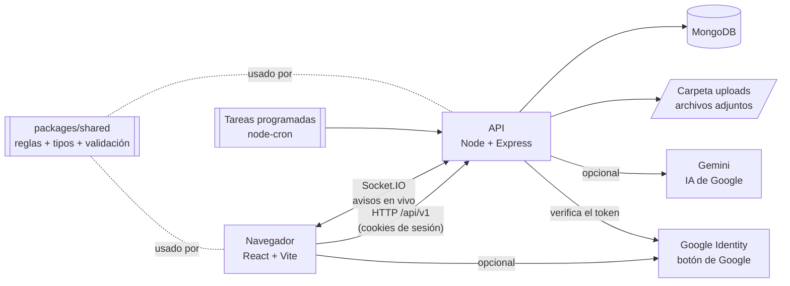
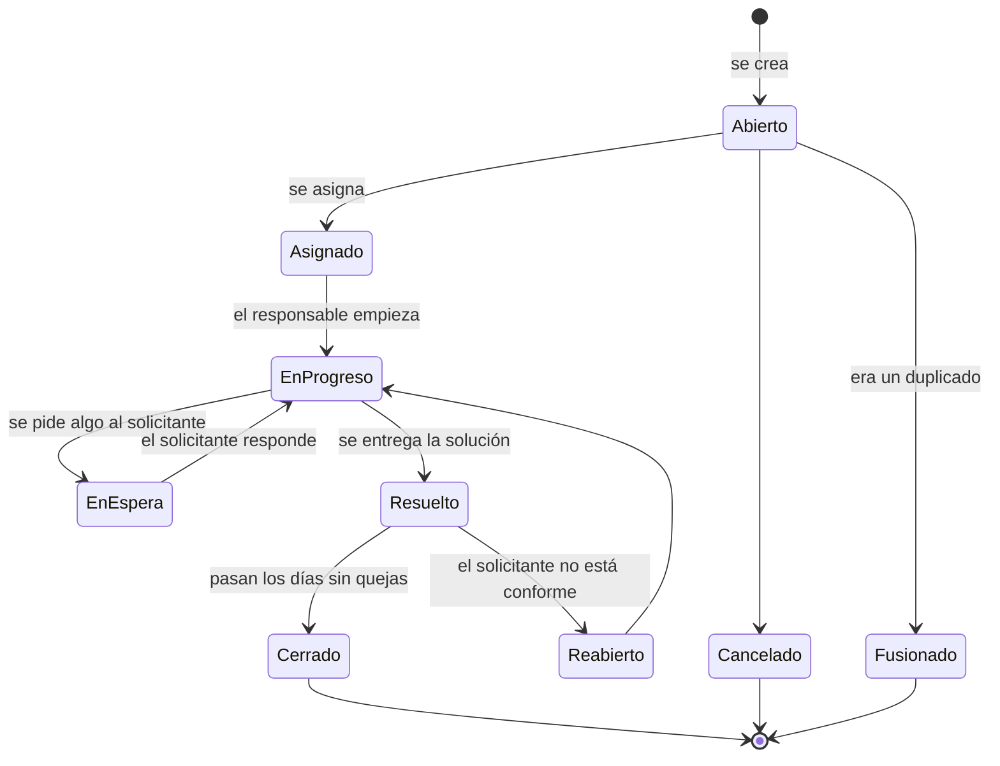

# Tekzaya · Documentación técnica

Tekzaya es una aplicación web para gestionar **solicitudes de soporte (tickets)** y el **mantenimiento de los equipos** de una organización. Está hecha en TypeScript, como un monorepo de tres paquetes: la interfaz (React), la API (Node + Express) y un paquete compartido con las reglas y los tipos. Guarda los datos en MongoDB y avisa en tiempo real con Socket.IO.

> Para usar la aplicación, ver `GUIA_DE_USUARIO.md`. Para el detalle funcional completo, ver `Tekzaya_Especificacion.md`. Este documento explica **cómo está construida**.

---

## 1. Arquitectura en una imagen



Cómo leerlo:

1. **El navegador** muestra las pantallas y pide datos a la API por HTTP. En desarrollo, Vite hace de proxy: el navegador llama a `/api/...` y Vite lo reenvía a la API (puerto 4000).
2. **La API** valida cada petición, comprueba permisos, lee y escribe en MongoDB y responde.
3. **Socket.IO** mantiene una conexión abierta para que la API avise al instante: un aviso nuevo, un ticket que cambió, un mensaje en la conversación.
4. **Las tareas programadas** corren dentro de la API cada pocos minutos: vigilan el SLA, cierran tickets olvidados y generan mantenimientos preventivos.
5. **El paquete compartido** contiene las reglas que deben ser iguales en los dos lados: estados, permisos, cálculo del SLA y esquemas de validación.
6. **Gemini y Google** son opcionales: sin sus claves, la aplicación funciona igual.

---

## 2. Tecnologías

| Parte | Tecnología | Para qué se usa |
| --- | --- | --- |
| Interfaz | React 19 + Vite 8 | Pantallas y servidor de desarrollo |
| Interfaz | Tailwind CSS 4 | Estilos, colores y tema claro/oscuro |
| Interfaz | TanStack Query | Pedir datos a la API y guardarlos en caché |
| Interfaz | React Router 7 | Navegación entre páginas |
| Interfaz | Recharts | Gráficas de Reportes |
| Interfaz | Motion · Sonner | Animaciones · avisos emergentes (toasts) |
| Interfaz | dnd-kit | Arrastrar tarjetas en el Kanban |
| API | Express 5 | Rutas HTTP |
| API | Mongoose 9 | Modelos y consultas a MongoDB |
| API | JSON Web Token + bcryptjs | Sesión en cookies y contraseñas cifradas |
| API | Socket.IO 4 | Tiempo real |
| API | node-cron | Tareas programadas |
| API | Multer | Subida de adjuntos |
| API | @google/genai | Funciones de IA con Gemini |
| API | google-auth-library | Verificar el inicio de sesión con Google |
| Compartido | Zod 4 | Validar los datos igual en la interfaz y en la API |
| Datos | MongoDB | Base de datos |
| Pruebas | Vitest + Supertest | Pruebas automáticas de la API |
| Pruebas | Playwright + axe | Pruebas en navegador y de accesibilidad |
| Calidad | oxlint | Revisión de código de la interfaz |

---

## 3. Estructura del repositorio

```
Tekzaya/
├── apps/
│   ├── api/          → la API (Express + MongoDB + Socket.IO)
│   └── web/          → la interfaz (React + Vite)
├── packages/
│   └── shared/       → reglas, tipos y validaciones que usan los dos
├── e2e/              → pruebas en navegador (Playwright)
├── docs/             → especificación, guías y este documento
├── uploads/          → archivos adjuntos (no se versiona)
└── .env              → configuración local (no se versiona)
```

### La API (`apps/api/src`)

| Carpeta | Qué contiene |
| --- | --- |
| `index.ts` · `app.ts` | Arranque del servidor y registro de todas las rutas |
| `config/` | Lectura y validación de las variables de entorno |
| `middleware/` | Exigir sesión (`auth`), validar cuerpos (`validate`) y manejar errores |
| `models/` | Esquemas de MongoDB: usuarios, áreas, tickets, mensajes, activos, avisos… |
| `modules/` | Una carpeta por funcionalidad, con sus rutas, servicios y pruebas |
| `jobs/` | Tareas programadas (SLA, ciclo de vida, disponibilidad, preventivos) |
| `realtime/` | Servidor Socket.IO y sus salas |
| `seed/` | Datos de ejemplo para desarrollo y demostración |
| `test/` | Utilidades de prueba (base en memoria, usuarios de prueba) |

Módulos de `modules/`: `auth`, `me`, `admin`, `areas`, `tickets`, `notifications`, `stats`, `reports`, `settings`, `ai`, `attachments`, `assets`, `workOrders`, `spareParts`, `plans`, `maintenance`, `health`.

### La interfaz (`apps/web/src`)

| Carpeta | Qué contiene |
| --- | --- |
| `pages/` | Una pantalla por archivo: Tablero, Tickets, Detalle, Reportes, Activos, Órdenes, Repuestos, Preventivos, Administración, Perfil, Login |
| `components/` | Piezas reutilizables: botones, modales, medidores, insignias, menús |
| `components/shell/` | El marco de la app: barra lateral, barra superior, campana |
| `api/` | Funciones que llaman a la API, una por recurso |
| `auth/` | Sesión actual y rutas protegidas |
| `realtime/` | Conexión Socket.IO y reacción a cada evento |
| `theme/` | Tema claro/oscuro |
| `lib/` | Utilidades: formatos de fecha, avisos (`notify`), enlaces |

### El paquete compartido (`packages/shared/src`)

| Archivo | Qué define |
| --- | --- |
| `enums.ts` | Estados, prioridades, roles y sus etiquetas en español |
| `ticket.ts` · `message.ts` · `user.ts` · `area.ts` | Forma de los datos y validación de entrada |
| `permissions/` | Quién puede hacer qué (una función por acción) |
| `sla/` | Cálculo de plazos en horario laboral |
| `notification.ts` · `realtime.ts` | Tipos de aviso y eventos del socket |
| `maintenance/` | Reglas del módulo de mantenimiento (costos, fiabilidad, calendario) |
| `ai.ts` · `settings.ts` · `report.ts` · `stats.ts` | IA, configuración, reportes y estadísticas |

**Idea clave:** si una regla vive en `shared`, la interfaz y la API **no pueden** contradecirse. Por ejemplo, el mismo esquema Zod valida el formulario de login en el navegador y la petición en el servidor.

---

## 4. Módulos funcionales

### Tickets (soporte)

- **Qué hace:** cualquier persona crea un ticket dirigido a un área (IT, Mantenimiento…). El área lo asigna, conversa con el solicitante y lo resuelve.
- **Conversación:** las respuestas son **públicas** (las ve el solicitante) o **notas internas** (solo el área).
- **Vistas:** Lista, Grupos y Kanban (con arrastrar y soltar), con pestañas como Sin asignar, Asignados a mí, Mi área, Mis solicitudes, Resueltos y Todos.
- **Acciones:** asignar (manual o reparto automático), tomar, transferir, fusionar duplicados, poner en espera, resolver, reabrir y encuesta de satisfacción (CSAT).
- **Dónde está:** `apps/api/src/modules/tickets`, `apps/web/src/pages/TicketsPage.tsx` y `TicketDetailPage.tsx`.

### SLA (plazos de atención)

Cada prioridad tiene dos plazos, contados **solo en horario laboral** (por defecto de 08:00 a 18:00, sin fines de semana ni festivos):

| Prioridad | Primera respuesta | Resolución |
| --- | --- | --- |
| Urgente | 15 min | 4 h |
| Alta | 1 h | 8 h |
| Media | 4 h | 24 h |
| Baja | 8 h | 72 h |

- **En tiempo / En riesgo / Vencido:** un ticket pasa a **En riesgo** al consumir el 75 % del plazo y a **Vencido** al pasarlo.
- **Pausa:** el reloj se detiene mientras el ticket está *En espera* (esperando al solicitante).
- **Configuración:** los plazos, la jornada y los festivos se cambian en Administración → Configuración.
- **Dónde está:** el cálculo en `packages/shared/src/sla/` y la vigilancia en `apps/api/src/jobs/sla.job.ts`.

### Mantenimiento de activos

- **Activos:** inventario de equipos (código `ACT-0001`), con estado *Operativo*, *En reparación* o *De baja*, historial, garantía y costos.
- **Órdenes de trabajo** (`OT-0001`): correctivas (una avería) o preventivas (programadas), con lista de verificación, repuestos usados y tiempo de parada. Estados: pendiente, asignada, en progreso, en espera, completada y cancelada.
- **Repuestos** (`REP-0001`): stock con mínimo; avisa cuando queda poco.
- **Preventivos:** planes que generan órdenes solas según su frecuencia, con vista de calendario.
- **Panel:** indicadores como disponibilidad, fallas repetidas y costos.
- **Enlace con tickets:** un ticket puede vincularse a un equipo y convertirse en una orden de trabajo.

### Reportes

- **Plantillas y reportes propios:** gráficas listas para usar, más reportes que cada persona arma y guarda.
- **Tipos de gráfica:** once (barras, líneas, áreas, anillo, radar, mapa de calor, tabla, KPI…).
- **Filtros y salida:** por área, persona y período, con exportación a CSV y PDF.
- **Dónde está:** `apps/api/src/modules/reports`, `stats` y `apps/web/src/pages/reportes/`.

### Inteligencia artificial

Ver la sección 7.

### Notificaciones

Ver la sección 6.

---

## 5. Ciclo de vida de un ticket



- **Estados activos:** Abierto, Asignado, En progreso, En espera y Reabierto. Son los que necesitan trabajo del área.
- **Estados finales:** Cerrado, Cancelado y Fusionado.
- **El SLA para al resolver:** el reloj se detiene en *Resuelto*, aunque el ticket todavía pueda reabrirse.
- **Cierres automáticos:** un ticket *Resuelto* se cierra solo tras 3 días hábiles. Uno *En espera* recuerda al solicitante a los 5 días y se cierra a los 10. Todo se puede cambiar en Configuración.
- **En el código:** los valores son en inglés (`open`, `in_progress`…) y las etiquetas en español están en `enums.ts`.

---

## 6. Roles, seguridad y tiempo real

### Roles

El rol base es **empleado** o **administrador**. A eso se le suman dos banderas:

| Perfil | Cómo se define | Qué puede hacer |
| --- | --- | --- |
| Empleado | `role: employee` | Crear tickets, ver los suyos y trabajar los que le asignan |
| Supervisor de área | empleado + `isAreaSupervisor` | Todo lo de su área: asignar, transferir, cancelar, reportes del área |
| Supervisor de RRHH | empleado + `hasGlobalReadAccess` | Leer tickets y reportes de todas las áreas |
| Administrador | `role: admin` | Todo, más usuarios, áreas, configuración e IA |

Los permisos están en `packages/shared/src/permissions/` como funciones pequeñas (`canReplyPublicly`, `canWriteInternalNote`, `isSupervisorOf`…). La API las aplica en cada ruta; la interfaz las usa para no mostrar botones que no funcionarían.

### Sesión y seguridad

- **Dos cookies `httpOnly`:** una de acceso que dura 15 minutos y una de renovación que dura 7 días. El JavaScript de la página no puede leerlas, lo que protege contra robo de sesión por XSS.
- **Contraseñas:** se guardan cifradas con bcrypt.
- **Bloqueo:** 5 intentos fallidos bloquean la cuenta 15 minutos.
- **Validación:** cada entrada se valida con Zod antes de tocar la base.
- **Adjuntos:** se guardan fuera de la carpeta pública y solo se descargan por un endpoint que comprueba permisos.
- **Google:** el botón "Continuar con Google" envía un token que la API verifica con Google. Solo entran personas ya invitadas, porque no hay registro público.
- **Avisos y permisos:** el solicitante nunca recibe ni ve notas internas.

### Tiempo real y notificaciones

Al iniciar sesión, el navegador abre una conexión Socket.IO y entra en tres tipos de **salas**:

- **La sala personal:** recibe sus avisos.
- **La sala de su área:** recibe los cambios en los tickets del área.
- **La sala de un ticket:** solo mientras tiene abierto su detalle.

Cómo llega un aviso a la pantalla:

1. Ocurre algo, por ejemplo un responsable deja una nota interna.
2. La API guarda el aviso en MongoDB y **después** lo emite por el socket. Así nunca se ve un aviso que no esté guardado.
3. El navegador lo recibe en `realtime/RealtimeContext.tsx`: sube el contador de la campana, refresca las listas y muestra un **toast** con el icono del tipo de aviso y un botón **Ver**.
4. Si la persona ya está viendo ese ticket, no sale el toast.

Algunos avisos (lista completa en `packages/shared/src/notification.ts`):

| Evento | Quién lo recibe |
| --- | --- |
| Ticket nuevo en el área | El supervisor, y todos los disponibles si es Urgente |
| Te asignaron un ticket | Los responsables nuevos |
| Respondieron a tu ticket | El solicitante |
| El solicitante respondió | Los responsables (o el supervisor si no hay) |
| Un compañero respondió o dejó una nota interna | Los demás responsables del ticket |
| SLA en riesgo / vencido | Los responsables y el supervisor |
| Orden de trabajo asignada, preventivo vencido, stock bajo | Los encargados de mantenimiento |

Regla general: **nadie recibe el aviso de su propia acción**.

### Tareas programadas

| Tarea | Frecuencia | Qué hace |
| --- | --- | --- |
| SLA | cada 10 min | Marca tickets en riesgo o vencidos y avisa |
| Ciclo de vida | cada hora | Cierres automáticos y recordatorios |
| Disponibilidad | cada hora | Devuelve a "disponible" a quien terminó su ausencia |
| Preventivos | cada hora | Genera las órdenes preventivas del día |
| Alertas de mantenimiento | cada hora | Garantías por vencer y fallas repetidas |

Están en `apps/api/src/jobs/`. Si una tarea falla, no tumba la API: se reintenta en la siguiente pasada.

---

## 7. Inteligencia artificial (Gemini)

La IA **ayuda pero nunca es obligatoria**. Si no hay `GEMINI_API_KEY`, las funciones no aparecen en pantalla y Administración → Configuración avisa y desactiva sus interruptores.

| Función | Dónde aparece | Qué hace |
| --- | --- | --- |
| Sugerir área | Crear ticket | Propone área y categoría a partir del texto |
| Clasificar | Detalle del ticket | Propone prioridad y categoría |
| Resumir | Detalle del ticket | Resume una conversación larga |
| Autocompletar | Respuesta | Sugiere cómo seguir escribiendo |
| Detectar incidentes | Tablero y detalle | Agrupa tickets parecidos ("posible caída de red") |
| Reparar o reemplazar | Detalle del activo | Recomienda si conviene reparar o cambiar el equipo |
| Estimar reparación | Orden correctiva | Estima el costo de la reparación |

- **Modelo:** `gemini-3.5-flash-lite`, elegido por velocidad (unos 0,7 s por sugerencia). Se cambia con `GEMINI_MODEL`.
- **Respuesta vacía permitida:** toda respuesta de IA admite `null`, y la interfaz lo contempla. Si Gemini falla o tarda, la pantalla sigue funcionando.
- **Control por función:** el administrador puede apagar cada función por separado.
- **Datos reales:** en el plan gratuito, Google puede usar el contenido enviado, así que no se deben mandar datos sensibles reales.
- **Dónde está:** `apps/api/src/modules/ai/` y `packages/shared/src/ai.ts`.

---

## 8. Cómo ejecutar el proyecto

### Requisitos

- Node.js 20 o superior.
- MongoDB: local (`mongodb://localhost:27017`) o Atlas.

### Pasos

```bash
# 1. Instalar dependencias (desde la raíz)
npm install

# 2. Crear la configuración
cp .env.example .env          # Git Bash
# Copy-Item .env.example .env # PowerShell

# 3. Cargar datos de ejemplo
npm run seed

# 4. Levantar API (4000) y web (5173) a la vez
npm run dev
```

Abrir `http://localhost:5173`. Todas las cuentas de ejemplo usan la contraseña `Tekzaya2026!`:

| Cuenta | Perfil |
| --- | --- |
| arisleyda.tejada@tekzaya.com | Administradora (IT y Sistemas) |
| daury.guzman@tekzaya.com | Supervisor de área (IT y Sistemas) |
| elena.paredes@tekzaya.com | Supervisora de RRHH, lectura global |
| diego.castillo@tekzaya.com | Empleado (Ventas) |

### Variables de entorno principales

| Variable | Para qué | ¿Obligatoria? |
| --- | --- | --- |
| `MONGODB_URI` | Conexión a la base | Sí |
| `PORT` · `WEB_ORIGIN` | Puerto de la API y origen permitido | Tienen valor por defecto |
| `JWT_SECRET` · `JWT_REFRESH_SECRET` | Firmar las sesiones | Solo en producción |
| `COMPANY_TIMEZONE` | Zona horaria de la jornada del SLA | Tiene valor por defecto |
| `UPLOAD_DIR` | Carpeta de adjuntos | Tiene valor por defecto |
| `GEMINI_API_KEY` · `GEMINI_MODEL` | Funciones de IA | No |
| `GOOGLE_CLIENT_ID` · `ALLOWED_GOOGLE_DOMAIN` | Inicio de sesión con Google | No |

### Comandos útiles

| Comando | Qué hace |
| --- | --- |
| `npm run dev` | API y web juntas, con recarga automática |
| `npm run seed` | Borra y vuelve a crear los datos de ejemplo |
| `npm run seed:refresh --workspace @tekzaya/api` | Renueva las fechas de los datos sin reiniciarlos |
| `npm run typecheck` | Revisa los tipos en todos los paquetes |
| `npm run lint` | Revisa el código de la interfaz |
| `npm run build` | Compila para producción |

---

## 9. Pruebas y calidad

| Tipo | Herramienta | Dónde | Cómo correrlas |
| --- | --- | --- | --- |
| API (unitarias e integración) | Vitest + Supertest | `apps/api/src/**/*.test.ts` | `cd apps/api && npx vitest run` |
| Reglas compartidas | Vitest | `packages/shared/src/**/*.test.ts` | `npm run test` |
| Navegador (de extremo a extremo) | Playwright | `e2e/*.spec.ts` | `npm run test:e2e` |
| Accesibilidad | axe + Playwright | `e2e/accesibilidad.spec.ts` | incluida en `test:e2e` |

- **Las pruebas de la API usan su propia base**, que se limpia en cada prueba. Conviene correrlas desde `apps/api`: desde la raíz pueden apuntar a la base de desarrollo y borrarla.
- **Recorridos en navegador:** las pruebas de Playwright cubren login, ciclo del ticket, Kanban, tiempo real, reportes, reparto automático, activos, averías, órdenes, repuestos, preventivos y la IA de mantenimiento (con respuestas simuladas).
- **Avisos:** las pruebas de notificaciones comprueban sobre todo **quién no** recibe un aviso. Un aviso de más es una fuga de información.

---

## 10. Glosario rápido

| Término | Significado |
| --- | --- |
| Monorepo | Un solo repositorio con varios paquetes que se instalan juntos |
| SLA | Plazo comprometido para responder y resolver un ticket |
| Responsable | Persona asignada a un ticket (puede haber varias) |
| Nota interna | Mensaje del ticket que solo ve el área, nunca el solicitante |
| OT | Orden de trabajo de mantenimiento |
| Preventivo | Mantenimiento programado, antes de que algo falle |
| Toast | Aviso emergente que aparece abajo a la derecha y se va solo |
| Sala (socket) | Grupo de conexiones que reciben los mismos eventos en vivo |
| Seed | Script que carga datos de ejemplo en la base |
